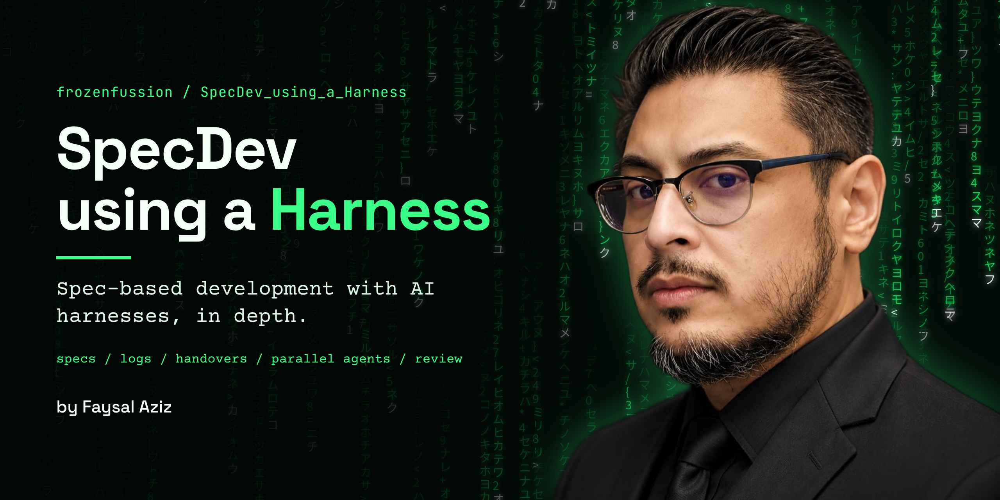
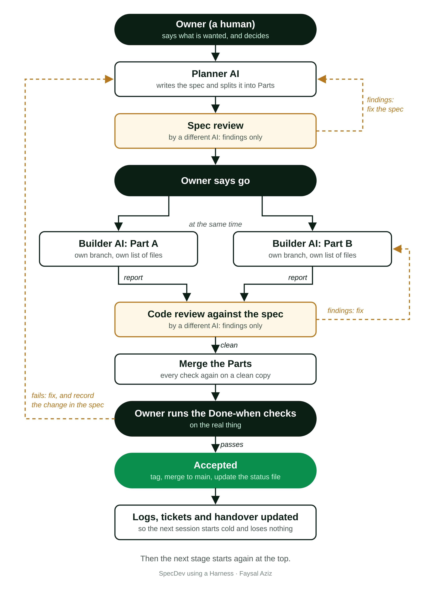

# SpecDev using a Harness

**Spec-based development with AI harnesses, in depth.** By Faysal Aziz.

This is the way I build real software with AI coding agents: several of them working at the same time, a different one reviewing, and a human who owns every decision. It is written so you can use it on almost any software project, with any language and any AI coding tool.

It is not a theory. Every chapter shows the rule and then shows the same thing in a product that was really built this way and is public: [open-office-harness](https://github.com/frozenfussion/open-office-harness). That includes the parts that went wrong.

## Who this is for

- Engineers who already use an AI coding tool and want results they can trust and repeat.
- Tech leads who want more than one AI agent working at once without the work colliding.
- Anyone who has asked an AI to "build the app" and got something that looked right and was not.

You need to be comfortable with git and a terminal. You do not need to know the tech stack of the worked example.

## The idea in one picture

Four ideas hold it together:

1. **The human owns every decision.** Agents suggest; only the owner decides. What the owner said is written down with a date.
2. **Nothing is built without a spec that can be checked.** "Done" is a list of commands with a pass or fail result.
3. **Roles are separate.** The agent that plans does not build. The agent that builds does not review its own work.
4. **Everything is written down.** Decisions, status, what failed and why. A new session can pick up exactly where the last one stopped.

## The chapters

| # | Chapter | What you will be able to do afterwards |
|---|---|---|
| 1 | [The big picture](chapters/01-the-big-picture.md) | Explain the whole loop and who does what |
| 2 | [The rules file](chapters/02-the-rules-file.md) | Write the rules every agent must follow, including what it must never do |
| 3 | [Writing a spec](chapters/03-writing-a-spec.md) | Write a spec a builder can follow and a reviewer can check |
| 4 | [Splitting work into Parts](chapters/04-splitting-work-into-parts.md) | Split one spec so several builders work at once without touching the same file |
| 5 | [Running several agents](chapters/05-running-several-agents.md) | Run and watch several agents in one terminal with tmux |
| 6 | [Reports and review](chapters/06-reports-and-review.md) | Get a fixed report from every builder and a findings-only review |
| 7 | [The logging system](chapters/07-the-logging-system.md) | Keep logs so no decision or lesson is ever lost between sessions |
| 8 | [Handover prompts](chapters/08-handover-prompts.md) | Start a fresh AI session that knows everything the last one knew |
| 9 | [Project management](chapters/09-project-management.md) | Keep a ticket board that always matches the plan and the logs |
| 10 | [The worked example](chapters/10-the-worked-example.md) | Follow a real product from an empty server to the cloud, stage by stage |

## Start here

- **Thirty minutes:** read chapters 1 and 3.
- **A first try on your own project:** copy [`templates/`](templates/) into your repo, fill in the rules file (chapter 2), write one small spec (chapter 3), and build it with one builder and one reviewer.
- **Ready for more:** add a second builder (chapters 4 and 5), then the logs and handovers (chapters 7 and 8).

## The templates

Blank files you can copy. Each one is explained in its chapter.

| Template | Chapter |
|---|---|
| [`00-GLOBAL-RULES.md`](templates/00-GLOBAL-RULES.md) | 2 |
| [`AGENTS.md`](templates/AGENTS.md) | 2 |
| [`stage-spec.md`](templates/stage-spec.md) | 3 and 4 |
| [`tmux-work.sh`](templates/tmux-work.sh) | 5 |
| [`builder-report.md`](templates/builder-report.md) | 6 |
| [`review-request.md`](templates/review-request.md) | 6 |
| [`fix-request.md`](templates/fix-request.md) | 6 |
| [`STATUS.md`](templates/STATUS.md) | 7 |
| [`logs/`](templates/logs/) | 7 |
| [`handover.md`](templates/handover.md) and [`handover-prompt.md`](templates/handover-prompt.md) | 8 |

## Words used here

| Word | Meaning |
|---|---|
| **Harness** | The program that wraps an AI model so it can work: read files, run commands, use tools, follow rules. A coding agent in your terminal is a harness |
| **Spec** | The written agreement for one stage: what to build and how to prove it is finished |
| **Stage** | One piece of the product that can be built, tested and accepted on its own |
| **Part** | A share of a stage given to one builder, with its own branch and its own list of files |
| **Owner** | The human who decides, tests and accepts |
| **Planner** | The AI that writes specs and keeps the records. It writes no product code |
| **Builder** | An AI that builds exactly one Part |
| **Reviewer** | A different AI that checks a spec or a Part and reports findings only |

## About the author

Faysal Aziz is an AI engineer with about 30 years of programming behind him. He builds AI systems for companies and teaches engineers how to do the same.

## Licence

[MIT](LICENSE). Use it, copy it, change it; keep the copyright notice.
