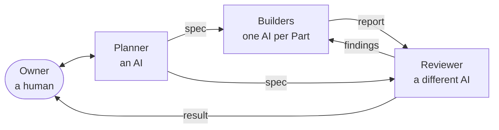
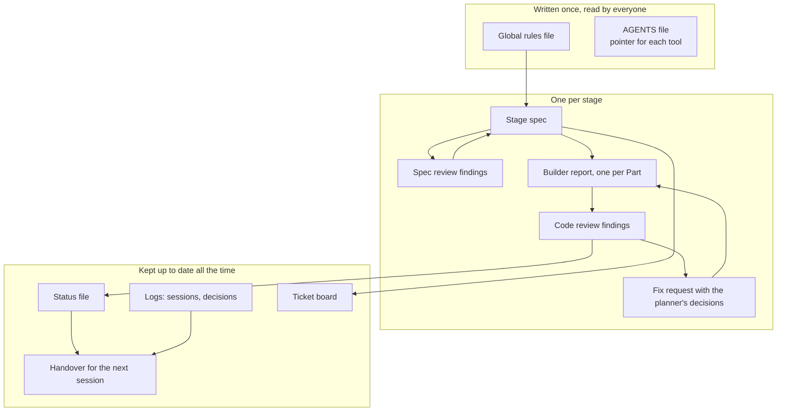
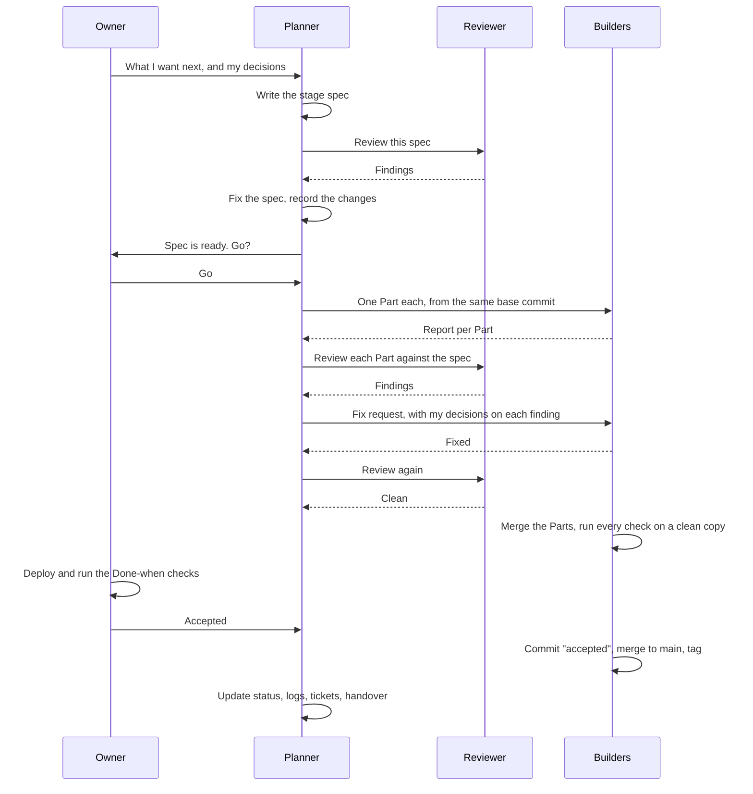

# Chapter 1: The big picture

Before any detail, this chapter gives you the whole method on one page: who is involved, what moves between them, and why it is arranged this way. Every later chapter zooms in on one piece.

As everywhere in this repo, each idea comes as **the rule** (for any project) and **the real example** (from [open-office-harness](https://github.com/frozenfussion/open-office-harness), a product built this way).

---

## 1.1 The problem this solves

An AI coding agent is fast, tireless and very good at producing code that looks right. Left alone with a loose request, it also does these things:

| What the agent does | Why it happens |
|---|---|
| Fills every gap in your request with a plausible guess | It predicts likely text; "likely" is not "what you meant" |
| Builds extra things you did not ask for | Being helpful is what it is trained to do |
| Says "done" when the code exists, not when it works | Nothing told it what "works" means |
| Forgets everything when the session ends | It has no memory except what is written in files |
| Agrees with its own work when asked to check it | The same reasoning that made the mistake reviews the mistake |
| "Fixes" a failing test by changing the test, the config, or yesterday's working code | Nothing fenced it in |

None of these is solved by a cleverer prompt. They are solved by structure: written agreements, separate roles, fences, and checks that a machine can run. That structure is what this repo describes.

---

## 1.2 The four roles

| Role | Does | Never does |
|---|---|---|
| **Owner** (human) | Says what is wanted. Decides every open question. Runs anything dangerous or privileged. Tests each stage. Says "accepted". | Hands a decision to an agent |
| **Planner** (AI) | Writes the rules and the specs. Splits each spec into Parts. Keeps the logs, the status file and the ticket board in step. | Writes product code |
| **Builder** (AI, one per Part) | Builds exactly what its Part says, on its own branch, in its own list of files. Runs the checks it is allowed to run. Reports in a fixed format. | Touches files outside its list, adds features, runs privileged commands, decides anything |
| **Reviewer** (a different AI) | Checks the spec before building and each Part after building, against the spec and the rules. Reports findings only. | Fixes what it finds, or praises |

**Why separate them?**

- **Planner and builder are separate** so that the plan is finished and reviewed before code exists. An agent that plans while it builds changes the plan to fit the code.
- **Builder and reviewer are separate** so that a mistake is not checked by the reasoning that made it. Use a fresh session, and if you can, a different model.
- **The owner is separate from all of them** because an AI cannot be accountable. Someone has to own the outcome.

**The real example.** In open-office-harness the roles were:

| Role | Who |
|---|---|
| Owner | Aziz |
| Planner | Claude, in a chat with access to the project's files, the terminal and the ticket board |
| Builders | Codex, one terminal window per Part: two at first, four from Stage 2 |
| Reviewer | Claude Code running in its own terminal window, in a fresh session each time |

This is written at the top of the project's rules file, as a table, so every agent reads its own job description before it does anything. Chapter 2 covers that file.

You do not need these exact tools. You need four roles and at least two different sessions. One person with one AI tool can run the whole method by opening separate sessions for planning, building and reviewing.

---

## 1.3 What moves between the roles

Everything that passes from one role to another is a file in the repo or a fixed-format message. Nothing important lives only in a conversation.

| Artefact | Written by | Read by | Chapter |
|---|---|---|---|
| Global rules | Planner, agreed by the owner | Every agent, every time | 2 |
| AGENTS file | Planner | Each tool, automatically at start | 2 |
| Stage spec | Planner | Builders, reviewer, owner | 3, 4 |
| Spec review | Reviewer | Planner | 3, 6 |
| Builder report | Builder | Reviewer, planner | 6 |
| Code review | Reviewer | Planner, then builder | 6 |
| Fix request | Planner | Builder | 6 |
| Status file | Builder at merge, planner | Everyone, especially a new session | 7 |
| Logs | Planner, every turn | The next session, the owner | 7 |
| Handover | Planner, at the end of a session | The next planner session | 8 |
| Tickets | Planner | The owner, at a glance | 9 |

---

## 1.4 The loop, step by step

One stage goes through these steps. The next stage starts again at the top.

| Step | What happens | What it produces |
|---|---|---|
| 1 | The owner and the planner talk until the stage is clear | Dated decisions |
| 2 | The planner writes the spec and commits it. That commit is the **base commit** | The spec, a base tag |
| 3 | A reviewer checks the spec. The planner fixes it. Repeat until clean | Fewer surprises |
| 4 | The owner says go | Permission |
| 5 | Each builder makes its own branch from the base commit and builds its Part | Code and a report per Part |
| 6 | The reviewer checks each Part against the spec and the rules | Findings |
| 7 | The planner decides each finding and sends a fix request. The builder fixes. The reviewer checks again | Clean Parts |
| 8 | The Parts are merged into one stage branch and every check runs again on a clean copy | A merged, checked branch |
| 9 | The owner deploys and runs the spec's "Done when" list | Proof, or a list of fixes |
| 10 | The owner says "accepted". The stage is merged to main and tagged | A tag you can always go back to |
| 11 | Status, logs, tickets and the handover are brought up to date | A next session that can start cold |

**The real example.** This exact sequence is section 5 of the project's rules file, "Build and deploy flow (every stage)", written as eight numbered steps. Two details in it are worth copying:

- The branch command is written out in full, so no builder invents its own layout:
  `git -C ~/projects/open-office-harness worktree add ~/projects/worktrees/stage-N-part-x -b stage-N-part-x <base commit>`
- The last step says exactly who merges and when: only after the owner has said the stage is accepted, the builder commits "Stage N: accepted", merges, pushes and tags.

---

## 1.5 Where the human stays in the loop

"Human in the loop" is easy to say. Here is what it means in this method.

| Moment | What the owner does | Why it cannot be an agent |
|---|---|---|
| Before the spec | Decides what is wanted | It is the owner's product |
| After the spec review | Says go | The last cheap moment to change direction |
| During the build | Watches, answers questions, reroutes | Agents must stop and ask; someone has to answer |
| Anything privileged | Runs it personally: admin commands, passwords, payments, DNS, firewalls | An agent with those powers can do damage that cannot be undone |
| After the review | Runs the checks and looks at the real thing | A passing test is not the same as a working product |
| At the end | Says "accepted" | Accountability |

The owner has three powers at every moment: **see** what each agent is doing, **reroute** it, and **approve** or refuse. Chapter 5 shows how one terminal layout gives you all three.

**The real example.** In the rules file, the owner's row reads:

> Owns every decision. Runs every `sudo` line himself, in a plain terminal [...]. Tests each stage. Says when a stage is accepted.

And when a builder needs something only the owner may do, the rule is that it writes the exact commands into a script and stops with one fixed sentence asking the owner to run it. It does not continue until the owner says it is done.

---

## 1.6 What you get for the effort

Writing rules and specs takes time. This is what it buys, taken from the real build:

| Result | Evidence |
|---|---|
| Stages accepted at a steady pace | Six acceptance tags in six days, from an empty server (9 Nov) to a copy running on managed cloud Kubernetes (14 Nov) |
| Several builders at once without collisions | Two parallel builders in Stages 0 and 1, four in Stage 2, each with its own file list |
| Mistakes caught while they are cheap | The Stage 1 spec review found 30 things before any code was written |
| Proof that can be re-run | By Stage 4 the check scripts printed 199 PASS lines and 0 FAIL on the live system |
| Sessions that can stop and restart | Each planner session ended with a handover file; the next one started from it |
| An honest record | Every stage's status entry lists what was built, what was checked, what deviated and what is still open |

It did not make the build free of problems. Chapter 10 walks through what went wrong at each stage and what changed because of it.

---

## 1.7 When this is too much, and when it is not enough

**Use less of it** for a throwaway script, a spike, or a one-file change. A short spec with a purpose, a "done when" and an "out of scope" is still worth the five minutes.

**Use all of it** when any of these is true: more than one agent works at once; the work spans more than one session; someone else must trust the result; a mistake costs money, data or reputation.

**What it does not replace:** your own engineering judgement. The method makes an agent's work checkable. Deciding what is worth building, and whether an architecture is sound, is still your job. If you cannot tell whether a spec is right, the agents cannot save you.

---

## 1.8 The method in ten lines

1. The human owns every decision. Write down what was decided and when.
2. One rules file says what every agent must and must never do.
3. One spec per stage. "Done" is a list of checks that can fail.
4. A different AI reviews the spec before anyone builds.
5. Split the spec into Parts with separate file lists. One builder per Part.
6. Every builder starts from the same commit, on its own branch.
7. Every builder ends with a report in a fixed format.
8. A different AI reviews each Part: findings only.
9. The owner runs the checks and says "accepted". Then merge and tag.
10. Keep the status, the logs and the handover current, so the next session starts cold and loses nothing.

---

**Next:** [Chapter 2, the rules file](02-the-rules-file.md).
