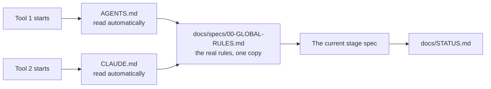
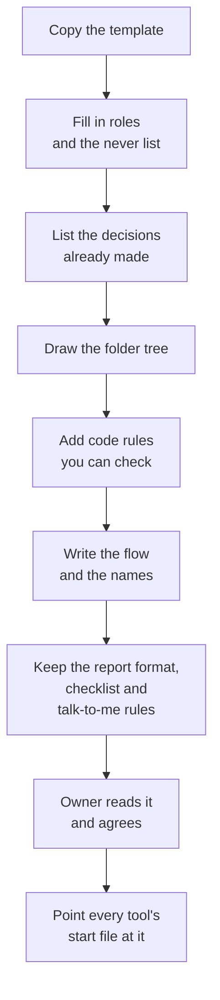

# Chapter 2: The rules file

A spec says what to build in one stage. The rules file says how *everything* is built, in every stage, by every agent. It is written once, agreed by the owner, and read by every agent before it does anything.

If you take only one thing from this repo, take this file. Most of the trouble people have with AI coding agents comes from rules that live in someone's head.

- **Template:** [`templates/00-GLOBAL-RULES.md`](../templates/00-GLOBAL-RULES.md) and [`templates/AGENTS.md`](../templates/AGENTS.md)
- **The real one:** [`docs/specs/00-GLOBAL-RULES.md`](https://github.com/frozenfussion/open-office-harness/blob/main/docs/specs/00-GLOBAL-RULES.md) in open-office-harness

---

## 2.1 Two files, and why

Each AI coding tool reads a file with a fixed name when it starts in a folder. The names differ by tool (`AGENTS.md` for some, `CLAUDE.md` for another, and others). You do not want your rules written three times in three files that drift apart.

**The rule.**

- Keep the real rules in **one** file inside the repo, next to the specs.
- Make each tool's start file a **short pointer** to it, with identical content in every start file.
- Put into the start files only the few rules that must be in front of the agent at every moment, copied word for word from the rules file.

**The real example.** The whole of the project's `AGENTS.md` starts like this:

> Read docs/specs/00-GLOBAL-RULES.md and the current stage spec in docs/specs/ before any work. Then read docs/STATUS.md.

After that line it repeats two sections of the rules file in full: how to talk to the owner, and who does what with the "never" list. Its headings say so: "MANDATORY, identical copy in AGENTS.md and CLAUDE.md". That is 41 lines. The rules file itself is 170.

The rules file opens with the sentence that sets its rank:

> A stage spec may add rules. It may not remove any rule in this file.

---

## 2.2 What goes in the rules file

Nine sections. The table shows what each is for; the rest of the chapter takes them one at a time.

| # | Section | The question it answers |
|---|---|---|
| 1 | Who does what | Who decides, who plans, who builds, who reviews, and what may a builder never do? |
| 2 | Fixed decisions | What is already chosen for the whole project? |
| 3 | Repo layout | Where does each kind of file live? |
| 4 | Code rules | What must be true of every line, in every language used? |
| 5 | Build and deploy flow | What are the steps of every stage, with the exact git commands? |
| 6 | Documentation rule | What must the user guide contain, and when is it updated? |
| 7 | Report format | What does a builder hand back at the end? |
| 8 | Review checklist | What does the reviewer check, every time? |
| 9 | How to talk to the owner | How does an agent phrase a question or an instruction to the human? |

A small project can merge some of these. Sections 1, 2, 7, 8 and 9 are never optional.

---

## 2.3 Section 1: who does what, and the "never" list

**The rule.** A table of roles (chapter 1), then a list that starts with the words "A builder never:". Then one sentence saying what a builder does when it needs something on that list.

**Why a "never" list works.** An agent told "be careful with the server" has nothing to act on. An agent told "never run `sudo`" has a rule it can check before every command. Write prohibitions as things that can be seen in a command or a diff.

**A starter list for any project.** Change the examples to fit yours.

| A builder never... | Why |
|---|---|
| runs privileged commands (`sudo`, admin consoles), or asks the owner to type a password into the agent | An agent with root can break what cannot be repaired |
| changes shared infrastructure (the cluster, the database server, the firewall, DNS) | Other things depend on it, and the change is not in a branch |
| starts background processes that outlive its command | They die or linger without anyone knowing |
| installs system packages | The next machine will not have them, and nobody will know why it worked |
| pushes to the main branch before the owner has accepted the stage | Main is the accepted product |
| changes a file its Part does not list | Another builder owns it |
| puts a password, token or key in the repo, a log, a commit message or a report | It is public the moment it is written |
| deletes data, migrations or audit records | Not undoable |
| adds a feature, table, dependency or test the spec did not ask for | Every extra is unreviewed scope |
| puts a client's name or anyone's personal data in the repo | Especially in a public repo |

**The escape hatch.** A prohibition without a way forward makes an agent either stall or cheat. So the list ends with what to do instead:

> When a builder needs something only the owner may do, it writes the exact commands into a script under `install/` and stops with: "Please run install/<file> as described in README". It does not continue until the owner says it is done.

That one sentence turns "I am not allowed" into a reviewable script and a clean stop.

**The real example.** The project's list has ten items and is very close to the table above, because the table was made from it. Two items are specific to that project and show how to adapt the idea:

> - changes the cluster: no `kubectl apply/create/delete/edit/patch/scale`, no `helm install/upgrade/uninstall`. Read-only `kubectl get/describe/logs` is allowed for checks;

Notice it names the exact commands, and it names what *is* allowed. An agent that may read but not write can still check its own work.

---

## 2.4 Section 2: fixed decisions

**The rule.** List the decisions that hold for the whole project, under the heading "do not revisit". Three groups work well: the product, the stack, and places and names.

**Why.** Every agent session starts fresh and will happily reopen a settled question, or quietly choose differently. A decision written here is closed. If the owner changes their mind, the line is edited, with the date.

**What to include.**

| Group | Examples |
|---|---|
| **Product** | Name, licence, the architecture rules ("a module talks to another only through a contract"), safety rules ("if the rights service does not answer, the answer is no") |
| **Stack** | Languages and major versions, database, messaging, sign-in, where it runs. Exact minor versions go in each stage spec, with the date checked |
| **Places and names** | Server names, folder paths, branch and tag naming, hostnames, where secrets live, time zone and language of the user interface |

**Write the reason for a decision when it stops an argument.** And put the owner's name and the date on anything that was a real choice.

**The real example.** Three lines from the project's fixed decisions show the range:

> - Kafka only where it solves a real problem (slow or bursty work, fan-out, survive a service being down, replay). Chat streaming and rights checks are direct HTTP calls.

A technology rule with its test built in.

> - **No AI model name, vendor, address or key in code or config in the repo** (Aziz, 10 Nov 2026: "There's not going to be any hard code"). AI is used by *purpose* [...]. Tests use a fake model, never a real one.

A design rule with the owner's own words and the date.

> - **Nothing is ever deleted.** Business tables have `deleted_at`; "delete" sets it. The audit trail is append-only, enforced by the database.

A rule that every builder of every service then had to follow, without being told again in each spec.

The same section also lists two *agreed exceptions* to the secrets rule, each with a date. Exceptions belong in the rules file, next to the rule they bend. An exception that lives only in a chat will be "fixed" by the next reviewer.

---

## 2.5 Section 3: repo layout

**The rule.** Draw the folder tree once, with one line per folder saying what lives there and from which stage it exists.

**Why.** Without it, the first builder invents a layout and the second invents another. With several builders working at once, the layout is also what makes separate file lists possible (chapter 4).

**The real example.** The project's tree shows each top-level folder with a note such as "from Stage 1" or "from Stage 3", and ends with:

> Each service, worker, consumer and app is its own package with its own lock file and its own Dockerfile. No shared code folder unless a spec creates one.

That last sentence prevents the most common way parallel builds collide: a "common" folder everyone edits.

---

## 2.6 Section 4: code rules

**The rule.** State what must be true of all code, then add a short paragraph per language or file type. Every rule must be checkable by a command or by reading a diff.

**Rules that pay for themselves on any project.**

| Rule | The check |
|---|---|
| Pin exact versions; commit lock files | Search for `^`, `~`, `>=`, `latest` |
| Every new dependency is named in the report with one line saying why | Compare the lock file to the report |
| No dependency for something the language or platform already does | The reviewer asks "what does this add?" |
| Logs never contain request bodies, passwords, tokens or personal details | Read the log calls |
| Every route validates its input and has at least one test | Count routes, count tests |
| Formatter and linter clean; warnings are errors | Run them |
| Every script is safe to run twice, prints a clear `STOP: <reason>` on failure and `DONE` on success | Run it twice |

**Write down the traps you have already fallen into.** A rules file grows from experience. When something bites you, add one line so it never bites again.

**The real example.** One line in the shell-script rules is plainly a scar:

> **Never pipe into `head` or `grep -q` under `pipefail`**; capture output into a variable first.

Nobody writes that rule in advance. It is there because a script once failed in a confusing way for exactly that reason, and writing it down cost one sentence. The review checklist (section 8) then checks for it by name.

---

## 2.7 Section 5: the build and deploy flow

**The rule.** Number the steps every stage goes through, and write the exact git commands for branches, worktrees, merges and tags.

**Why spell out git?** Because every agent knows git and every agent would do it slightly differently. The naming of branches and tags is also what lets a script, a reviewer, or you find anything later.

Chapter 1 showed this flow as a diagram. The naming scheme from the real project is worth copying as it is:

| Thing | Name | Example |
|---|---|---|
| Base commit of a stage | tag `stage-N-base` | `stage-2-base` |
| A Part's branch and worktree | `stage-N-part-x` | `stage-2-part-c` |
| The merged stage branch | `stage-N` | `stage-2` |
| The accepted stage | a version tag | `spine-v0.2` |
| The acceptance commit | message "Stage N: accepted" | |

---

## 2.8 Section 6: the documentation rule

**The rule.** Say what the user guide must contain and that it is updated in every stage, by the builder, as part of the work.

**The real example.**

> Every `README.md` starts with a **QUICK GUIDE** before anything else: short numbered steps, exact copy-paste commands, the terminal to type each in, and the good result of each, written so simply that a six-year-old can follow.

It then lists what the guide must cover: set up, deploy, check, start, stop, restart, status, logs, run tests, what each `STOP:` message means, and what to do after a reboot. Because it is in the rules, the reviewer checks it like code.

---

## 2.9 Sections 7 and 8: the report format and the review checklist

These two get their own chapter (6). What matters here is that they live in the rules file, so that:

- every builder ends every Part with the same seven headings, and
- every review checks the same numbered list.

Fixed formats are what let you compare Part A with Part B, or this stage with the last one, at a glance.

---

## 2.10 Section 9: how to talk to the owner

This is the section people skip, and the one that saves the most of your day.

**The rule.** Tell the agents exactly how to phrase anything the human must read or do.

**The real example,** nearly in full, because every line earns its place:

> - Anything [the owner] must act on or decide goes at the TOP of the message.
> - Every command you give [...] starts with one line saying exactly where to type it [...].
> - If a command asks for a password, say which one [...].
> - Say which folder to be in, with the exact `cd` command, or "the folder doesn't matter for this command".
> - Give every command one short plain-English line saying what it does.
> - Short, plain instructions. No jargon. One step at a time; wait for [the owner's] output before the next step.
> - Say things in plain words. Never refer to something only by an internal number or code.
> - When a correction is needed in text [the owner] will paste, give the complete corrected text, never "change this line".
> - Never make assumptions. If something is not in the spec, stop and ask [...] one short question, saying why it matters.

**Why this belongs in the rules.** The human is the slowest and most expensive part of the loop. An agent that buries the one thing you must do under three paragraphs, or tells you to "run the migration" without saying where, wastes the only resource that does not scale. The last line is also the method's main safety valve: *stop and ask* is always allowed, and guessing never is.

This section is the one copied word for word into every tool's start file, so it is in front of the agent in every turn.

---

## 2.11 How to write your own, in an hour

1. **Copy the template** into `docs/specs/00-GLOBAL-RULES.md`.
2. **Roles.** Fill the table. Adjust the "never" list to your environment: what is privileged, what is shared, what cannot be undone?
3. **Fixed decisions.** Write only what is truly decided. Leave the rest for the first spec.
4. **Layout.** Draw the tree, even if most folders do not exist yet.
5. **Code rules.** Start with pinning, logging, tests, formatter. Add a line each time something bites.
6. **Flow and names.** Copy the naming scheme unless you have a reason not to.
7. **Keep sections 7, 8 and 9 nearly as they are.** Change the names.
8. **The owner reads every line and agrees.** These are the owner's rules.
9. **Create the start files** for the tools you use, each pointing at the rules file, each with the same content.

---

## 2.12 Keeping it alive

| When | What to do |
|---|---|
| The owner makes a project-wide decision | Edit the line in "Fixed decisions", with the owner's name and the date |
| Something goes wrong for a reason that could recur | Add one checkable rule, and one line to the review checklist |
| A rule is bent on purpose | Write the exception next to the rule, with its limit and the date |
| A spec needs a stricter rule for one stage | Put it in the spec. Specs may add rules, never remove them |
| A rule is no longer true | Change it in the rules file first, then everywhere it is copied |

**The real example.** The roles table itself changed during the build. The owner's row gained this, in the middle of the sentence about who runs what:

> from Stage 2 Claude runs the non-sudo deploy and check scripts in his shell tile where he watches (Aziz, 10 Nov 2026)

The rule moved, the date and the name went in with it, and the same edit was made in both start files.

---

## 2.13 Common mistakes

| Mistake | What it causes | Do this instead |
|---|---|---|
| Rules that cannot be checked ("write clean code") | Ignored | Write what a reviewer can see in a diff or a command |
| A "never" list with no way forward | The agent stalls, or works around it | Add "write the commands into a script and stop" |
| Different text in each tool's start file | Agents follow different rules | One rules file; identical pointers |
| Putting stage details in the rules file | It grows until nobody reads it | Project-wide here; stage-specific in the spec |
| Exceptions agreed in chat only | The next reviewer reports them as bugs | Write them next to the rule |
| Never updating it | The same mistake, again | One new line per lesson |

---

## 2.14 Checklist

- [ ] One rules file in the repo; every tool's start file points to it with identical text.
- [ ] A roles table that names who decides, plans, builds and reviews.
- [ ] A "never" list made of things visible in a command or a diff.
- [ ] A sentence saying what a builder does when it hits the list.
- [ ] Fixed decisions, with names and dates on real choices.
- [ ] A folder tree.
- [ ] Code rules that a command or a reviewer can check.
- [ ] The stage flow with exact branch and tag names.
- [ ] The report format and the review checklist.
- [ ] Rules for how agents talk to the owner, ending with "stop and ask".
- [ ] The owner has read it and agreed.

---

**Next:** [Chapter 3, writing a spec](03-writing-a-spec.md).
