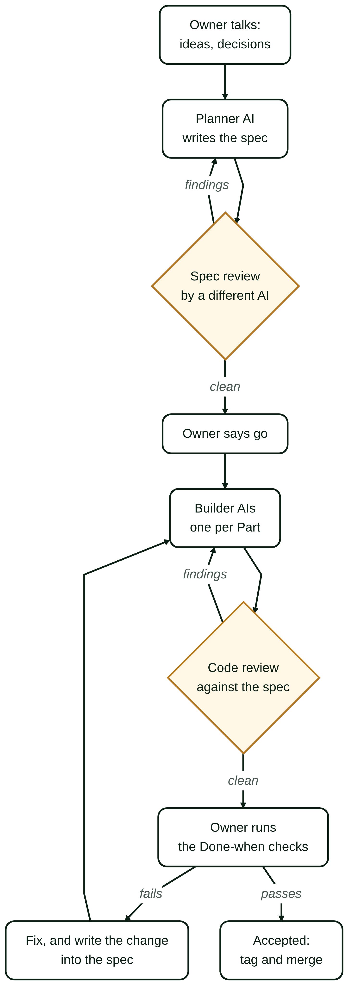
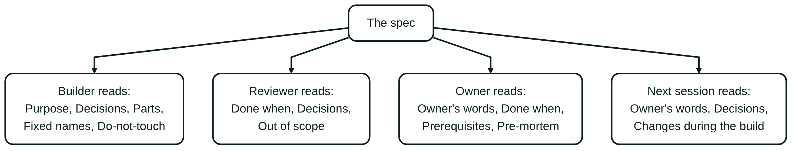
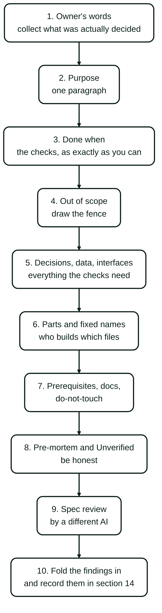

# Chapter 3: Writing a spec

A spec is the one document that tells an AI builder exactly what to build, tells a reviewer exactly what to check, and tells you exactly how to know it is finished. If the spec is good, the build is quiet. If the spec is thin, you spend the build answering questions and undoing guesses.

This chapter shows how I write one. Every section has two halves:

- **The rule**, which works for any software project, in any language, with any harness.
- **The real example**, taken from a spec that was actually built: [Stage 1 of open-office-harness](https://github.com/frozenfussion/open-office-harness/blob/main/docs/specs/stage-1-control-centre.md). Open it in a second tab and keep it there while you read.

- **Template:** a blank copy you can fill in is in [`templates/stage-spec.md`](../templates/stage-spec.md).

---

## 3.1 Where the spec sits

The spec is the hand-over point between thinking and building. Everything before it is conversation. Everything after it is checked against it.

<p align="center"></p>

Three things to notice:

1. **The spec is reviewed before anyone builds.** A mistake found in the spec costs a sentence. The same mistake found in the code costs a rebuild.
2. **The code is reviewed against the spec**, not against the reviewer's taste. Without a spec, a review is only an opinion.
3. **When reality disagrees with the spec, the spec is updated**, in a section made for that. The spec stays true to the end.

---

## 3.2 Who reads a spec

A spec has four readers, and each one needs something different from it.

| Reader | What they need from the spec | If it is missing |
|---|---|---|
| **The builder** (an AI) | Exactly which files to make or change, and what each must do | It guesses, and it guesses plausibly, which is worse than guessing badly |
| **The reviewer** (a different AI) | Statements it can check as true or false | It reviews style, because there is nothing else to review |
| **The owner** (you) | Commands to run and the result that means "it works" | You judge by feeling, or by reading code you did not write |
| **The next session** (you or an AI, weeks later) | Why each decision was made, and what changed during the build | Decisions get re-argued, and old mistakes come back |

<p align="center"></p>

Write every sentence so that at least one of these four can use it. A sentence none of them can act on does not belong in a spec.

---

## 3.3 The anatomy of a stage spec

A stage is one piece of the product that can be built, tested and accepted on its own. Each stage gets one spec. This is the full list of sections, in the order they appear in the file.

| # | Section | The question it answers |
|---|---|---|
| Header | Date, author, base commit, acceptance tag | Where does this work start, and how is the finish marked? |
| 0 | The owner's words and decisions | What did the human actually say, and when? |
| 1 | Purpose | What exists after this stage that did not exist before? |
| 2 | Done when | How do we prove it is finished? |
| 3 | Prerequisites | What must be in place before any builder starts? |
| 4 | Decisions for this stage | What is already chosen, so nobody chooses again? |
| 5 | Data model | What is stored, and what are the rules on it? |
| 6 | Interfaces | What goes in and out, and who may call it? |
| 7 | Parallel Parts | Who builds which files? |
| 8 | Fixed names between the Parts | What must two builders spell the same way? |
| 9 | Documentation to add | What must the user guide say afterwards? |
| 10 | Files that must not change | What is off limits? |
| 11 | Pre-mortem | What will probably go wrong, and what do we do then? |
| 12 | Unverified | What did the spec author not manage to check? |
| 13 | Out of scope | What must the builder not build, even if it seems helpful? |
| 14 | Changes agreed during the build | What did we learn, and what overrides the text above? |

Not every project needs all sixteen. A small script has no data model and no parallel Parts. But Header, 0, 1, 2, 4, 10, 13 and 14 are never optional. The sections below go through each one.

To keep the generic half concrete, I use one made-up example all the way through: **"Stage 2: reminder emails for unpaid invoices"** in an imaginary invoicing app. It has nothing to do with the real example, which is on purpose: the method is the same for both.

---

## 3.4 The header: a fixed starting point

**The rule.** Say the date, who wrote the spec, the exact commit the work starts from, and the tag that will mark acceptance. Every builder starts from the same commit. Give that commit a tag so nobody types a hash.

**Why.** Two AI builders working at the same time must start from identical code, or their work will not merge. And "it worked on my branch" means nothing unless everyone knows which commit the branch grew from.

**Made-up example.**

```
# Stage 2: Reminder emails for unpaid invoices
Written 2026-03-04 by the planner. Read 00-GLOBAL-RULES.md first; it applies in full.
Base commit: main right after this spec is merged, tagged stage-2-base.
Tag when accepted: v0.2.
```

**The real example.** The Stage 1 spec opens with the date, the author, the instruction to read the global rules first, and this:

> **Base commit:** `main` right after this spec is merged. Before any Part starts, Codex tags that commit `stage-1-base` and pushes the tag [...]. Every Part starts from that tag.
> **Tag when accepted:** `spine-v0.1`.

Notice the spec itself is merged first. The spec is part of the starting point, so every builder has it in its own copy of the repo.

---

## 3.5 Section 0: the owner's words and decisions

**The rule.** Before any design, list what the human owner said that shaped this stage. Short, dated, timestamped where you can, in quotation marks when it is a direct quote. One line per decision.

**Why this section comes first.** It is the most important habit in the whole method, for three reasons:

- **It stops the AI's ideas from becoming the owner's decisions.** A planner AI suggests many things in conversation. Only what the owner agreed to goes here. Everything else in the spec must trace back to this list or to the global rules.
- **It ends arguments.** When a builder or reviewer questions a choice, the answer is a dated line, not a memory.
- **It survives the session.** The conversation where the decision was made will be gone. This line will not.

**How to write it.**

- Use the owner's own words where they are short enough. "Yes, I agree" next to the thing agreed is enough.
- Give the reason when the owner gave one.
- Include decisions that say *no*. "No object storage server" is as binding as any yes.
- Never put a guess here. If the owner did not say it, it goes to section 4 as the author's decision with a reason, or you ask.

**Made-up example.**

```
## 0. The owner's words and decisions
- 02 Mar 10:14: Reminders go out on day 7 and day 21 after the due date, never more than two.
- 02 Mar 10:20: "No new email provider." Use the SMTP relay we already pay for.
- 03 Mar 16:02: A customer marked "in dispute" never gets a reminder.
```

**The real example.** Section 0 of the Stage 1 spec has seven dated lines. Two of them show the pattern well:

> - 07 Nov 16:26: Rights are fixed rules in the Control Centre, never decided by an AI; the classifier only suggests.
> - 09 Nov 16:18: "Do not unnecessarily add a tech stack." Always the simplest step that does not cut corners. [...]

The second line later decided a real design question (where files are stored) without any further discussion. That is the section doing its job.

---

## 3.6 Section 1: Purpose

**The rule.** One short paragraph and a short list: what exists after this stage that did not exist before. Then one line saying what this stage deliberately does *not* contain.

**How to write it.** Name the thing by what it does, not how it is built. If the purpose needs more than about six lines, the stage is too big: split it.

**Made-up example.**

```
## 1. Purpose
Send reminder emails for unpaid invoices: one program that
- finds invoices 7 and 21 days past due, once a day;
- sends one email per invoice through the existing SMTP relay;
- records every email sent, so none is ever sent twice.
No user interface. No SMS. No change to how invoices are created.
```

**The real example.** The Stage 1 purpose replaces a placeholder with one real program that does four named things (rights checks, two registries, approvals, its own audit trail), then closes with:

> No AI model is called. No user interface (the Admin Console is Stage 4). [...]

That closing line is the first defence against a builder being "helpful".

---

## 3.7 Section 2: Done when

This is the section that decides whether the spec is good. **Write it first**, even though it appears second.

**The rule.** A numbered list of checks. Each check is something a person can run or look at, with a result that is plainly pass or fail. The stage is finished when all of them pass, and not before.

**What a good check looks like.**

| Weak | Strong |
|---|---|
| "The API is secure" | "`GET /api/reminders` without a token returns 401" |
| "Emails are not duplicated" | "Run the job twice on the same day: the count of rows in `emails_sent` does not change" |
| "It survives a restart" | "After `sudo reboot`, the check script passes again without anyone touching the server (allow 5 minutes)" |
| "Code quality is good" | "In a clean copy of the branch, the formatter, the build with warnings as errors, and the tests all pass" |
| "Documentation is updated" | "The README Quick Guide covers every item in section 9" |

**Five kinds of check that most stages need.**

1. **It builds**: the artefact (an image, a package, a binary) is produced by the pipeline and can be fetched.
2. **It deploys**: the install scripts run in order and each ends with a clear word such as `DONE`.
3. **It behaves**: one check script prints `PASS` or `FAIL` per line. Include the refusals (no token, wrong role, bad input), not only the happy path.
4. **It survives**: after a reboot or restart, everything passes again with no human help.
5. **It is clean**: formatter, compiler warnings, tests and linters, run on a clean copy.

**Put the check into a script.** If the Done-when list is a script that prints `PASS` or `FAIL`, three good things happen. The builder can run it. The reviewer can read it. And you can run it again after every later stage to prove nothing broke.

**Made-up example.**

```
## 2. Done when (all of these)
1. The pipeline builds the reminders program on every push that changes src/reminders/, and the run is green.
2. scripts/check-reminders.sh prints PASS for every line and ends with DONE. It checks:
   a. an invoice 7 days past due gets exactly one email;
   b. running the job a second time the same day sends nothing new;
   c. an invoice whose customer is "in dispute" gets no email;
   d. with the SMTP relay switched off, the job ends with a clear error and marks nothing as sent.
3. In a clean copy of the branch: the formatter, the build and the tests pass.
4. The README says how to run the job by hand and how to read its log.
```

**The real example.** Section 2 of the Stage 1 spec has six numbered checks. The third is a check script with ten lettered sub-checks, (a) to (j). Read three of them closely, because they show how exact a check can be:

- **(a)** a call without a token must return 401.
- **(g)** the same event is published *twice with the same id*, and after waiting there must be *exactly one* pending approval. That one line proves the duplicate handling works, which is the hardest thing to get right in an event-driven system.
- **(j)** an attempt to change or delete an audit row must *fail*, tried as two different database roles, inside a transaction that is rolled back. The spec even says: "A statement that succeeds is a FAIL."

And the fourth check is the survival one:

> After `sudo reboot`, [the two check scripts] pass again without anyone touching the server (allow 5 minutes).

---

## 3.8 Section 3: Prerequisites

**The rule.** List what must exist before a builder starts: tools installed, accounts made, databases created. For each one, say who does it and give the exact command with the result that means it worked.

**Why.** An AI builder that hits a missing tool will try to install it, work around it, or quietly skip the tests that needed it. All three are worse than stopping. A prerequisite list means it never has to choose.

**The real example.** Stage 1 needed the .NET SDK on the server. The spec gives one command, says which terminal to type it in, says it asks for no password, and ends with:

> Good result: `10.0.403`.

It also handles an ordering problem openly: one Part's tests need a database that the other Part's script creates. The spec says which comes first and what the first builder does in the meantime ("runs only the tests that need no database and says so in its report").

---

## 3.9 Section 4: Decisions for this stage

**The rule.** A table of every choice the builder would otherwise make alone: versions, libraries, names, patterns. Three columns: the item, the decision, and why. Versions are exact, and the spec says the date they were checked and where.

**Why a "why" column.** A builder that knows the reason makes better small choices in the gaps. A reviewer can tell a real deviation from a sensible one. And six months later, you can tell whether the reason still holds.

**How to fill it.**

- **Check every version on the day.** An AI's memory of "the latest version" is old by definition. Look it up from the source (the release page, the package registry) and write the date.
- **Decide the patterns that cross files**: how errors look, how duplicates are handled, how secrets reach the program, how retries work.
- **Record the choice you did not make.** "No new email provider" belongs here as much as the library you picked.
- **No new technology without a problem it solves.** If the "why" column is hard to fill, that is your answer.

**Made-up example.**

```
| Item | Decision | Why |
|---|---|---|
| Schedule | The platform's existing daily job runner, 06:00 UTC | Already there; no new scheduler |
| Email | Existing SMTP relay, the library already used by the invoices module, version X.Y.Z (checked 04 Mar on the registry) | The owner's decision, section 0 |
| No duplicates | Table emails_sent with a unique key on (invoice_id, reminder_number); the row is written in the same transaction that marks the email queued | A crash between "sent" and "recorded" must not send twice |
```

**The real example.** Section 4 of the Stage 1 spec is a table of about twenty rows, headed:

> fixed; versions verified 09 Nov 2026 from dotnet release metadata, nuget.org, mcr.microsoft.com and GitHub releases

One row is worth studying. The program has to save a change and also publish a message about it. The decision is an "outbox table", and the why column says:

> Without it a crash between "saved" and "published" loses a decision. No new technology: one table and one loop

That is the whole method in one cell: a named problem, the simplest thing that solves it, and a note that nothing new was added.

---

## 3.10 Sections 5 and 6: the data model and the interfaces

**The rule.** If the stage stores data, list every table with what it holds and the rules on it. If the stage has an interface (an HTTP API, a command line, a message topic, a file format), list every entry with who may use it and what it does, including what happens on bad input and on failure.

**What to always state.**

- **Who may call each thing.** Not "authenticated users" but the exact condition.
- **What happens when it fails.** For example: any internal error returns 503, and callers treat that as "not allowed".
- **What is never allowed.** For example: no row is ever deleted; "remove" sets a date.
- **How lists are limited and ordered**, so two builders do not invent two kinds of paging.

**The real example.** Section 5 lists nine tables and one rule that covers them all: nothing is ever hard-deleted, and a database trigger enforces it "with no exception for any role". Section 6 is a table of routes where the "Who" column is defined from the token itself (admin, a named service, or the user themselves).

If your project has neither data nor an interface in this stage, leave these two sections out. Do not write "not applicable" fourteen times.

---

## 3.11 Section 7: Parallel Parts

Chapter 4 covers splitting work in depth. What matters here is what the spec must say.

**The rule.** If more than one builder works on the stage, split it into Parts. Each Part gets a branch, a builder, an explicit list of files ("only these"), what to build, and its own "done when". Then one sentence that makes it safe:

> **Rule: Part A changes no file Part B lists, and the reverse.**

Then say how the Parts are merged and what is checked after the merge.

**How to find the split.** Look for a line where the two sides need each other only through names: code on one side and "getting it running" on the other; one service and another; the back end and the front end. If two Parts need the same file, either move the line or give that file to exactly one of them.

**The real example.** Stage 1 was split by "code versus getting it running":

- **Part A** owned the program's source folder and its API description.
- **Part B** owned the build pipeline, the deployment files and the install and check scripts.

Each file list is literal. Part B's list even explains, per file, what changes: one script is listed with "(stop applying the control-centre-api placeholder; nothing else changes)".

---

## 3.12 Section 8: Fixed names between the Parts

**The rule.** Anything two Parts must spell identically goes in one table: port numbers, environment variable names, secret names, image names, file paths.

**Why.** Two builders working at the same time cannot ask each other. If Part A reads `DB_URL` and Part B sets `DATABASE_URL`, both pass their own checks and the product fails on first run. This table is the only place they meet.

**The real example.** Section 8 fixes the port (8080), the image name and tag format, seven environment variable names with the secret each comes from, and the Kubernetes names. The tag format is repeated on its own row at the bottom, "first 12 characters of the commit hash, on GitHub and on harness", because that exact detail had already been found wrong once in review.

---

## 3.13 Section 9: Documentation to add

**The rule.** List what the user guide must say after this stage, in order. Each step says where to type it, which password it asks for, and what the good result looks like.

**Why it is in the spec.** Documentation written afterwards from memory is always missing the step that mattered. Listing it here makes it a deliverable the reviewer checks, the same as code. The last item in the real list is the one people forget:

> Every new `STOP:` and `FAIL` message and what to do.

---

## 3.14 Section 10: Files that must not change

**The rule.** Name the files and folders the builder may not touch, and say what it does if it believes one must change: stop and ask, with the reason.

**Why.** An AI fixing a failing test will happily "fix" the rules file, the spec, or last stage's working code. This section, plus the "only these files" lists, is what keeps a build inside its fence.

**The real example.**

> If Codex believes one must change, it stops and asks Aziz with the reason.

---

## 3.15 Section 11: the pre-mortem

**The rule.** Before the build, imagine it has already failed. Write a table: the step, the failure, how it shows, and what to do.

**Why.** You will usually be right about half of them. For those, the fix is already written and nobody panics. The other half teach you something for the next spec.

**Made-up example.**

```
| Step | Failure | How it shows | Action |
|---|---|---|---|
| Sending | The relay refuses the login | Job log: "535 authentication failed" | The relay password secret is missing in this environment; create it, re-run |
| Daily job | Runs twice (two copies of the runner) | Two log lines with the same date | Allowed: the unique key refuses the second insert; nothing is sent twice |
```

**The real example.** Section 11 lists eight likely failures. One of them:

> Kafka client in chiseled image | crash at start: native library cannot load | pod log | switch the run image to [the larger one], record it as a deviation

Notice the last three words. Even the fallback says how it gets written down.

---

## 3.16 Section 12: Unverified

**The rule.** List everything the spec author believes but did not manage to check. Say what happens if it turns out wrong.

**Why this matters more with AI than with people.** An AI planner writes things it has not checked in exactly the same confident voice as things it has. This section forces the difference into the open. An honest "I could not check this" costs nothing. A confident wrong statement costs an afternoon.

**The real example.** Section 12 is headed:

> UNVERIFIED (each script stops with a clear message if wrong)

and lists five items, each a single plain sentence, such as whether a network path that worked from the server would also work from inside a container.

---

## 3.17 Section 13: Out of scope

**The rule.** List what belongs to later stages or to nobody, and end with an instruction not to prepare for it.

**The real example.**

> [...] Codex does not pre-build any of it.

Short, and it works. Without it you get empty folders, unused settings and "hooks for later" that the next stage then has to work around.

---

## 3.18 Section 14: Changes agreed during the build

**The rule.** A numbered, dated table at the end of the spec. Every change agreed after the spec was first written goes here: what changed, who agreed it and when. The heading says these entries override the sections above.

**Why not just edit the sections?** Small corrections are folded into the sections too, but the table is the history. It tells the next reader *that* something changed and *why*, which the corrected text alone cannot.

**What goes in.**

- Findings from the spec review that changed the spec.
- Exceptions the owner accepted, with the limit of the exception.
- Decisions made while fixing review findings.
- Fixes found only when the thing was run for real.

**The real example.** This is the most useful section of the real spec to read in full, because it is the honest record of what the first version got wrong. Ten entries. A few of them:

| What it records | Why it is worth reading |
|---|---|
| The spec review found **30** things before any builder started; the re-review of the fixes found **8** more | The review of the spec is not a formality. And fixes create new mistakes, so you review again |
| The owner accepted one exception to the "secrets only in the secret store" rule: a settings file for the *test* database only | An exception is fine when it is written down, limited, and has a name next to it |
| The live run could only happen *after* the two Parts were merged, because one Part built the image and the other held the code | This gap was found when one builder asked for the other's image tag. The spec had given both Parts a "done when" that neither could meet alone |
| Four fixes found only on the first real run: the program listened on the wrong port, a missing system library in the small image, a stray newline in a secret, a sign-in step that needed an extra parameter | No spec and no review catches everything. That is why the owner runs the Done-when checks |

That third row is the kind of mistake this whole section exists for. The spec was reviewed twice and still had it. It was caught in minutes because the builder stopped and asked instead of inventing something, which is what the rules told it to do.

---

## 3.19 The order to write it in

You do not write a spec from top to bottom.

<p align="center"></p>

**Done when comes third, straight after the purpose.** If you cannot write the checks, you do not yet know what you are building, and no amount of design detail will hide that.

---

## 3.20 Reviewing the spec before anyone builds

Have a different AI, in a fresh session, review the spec before a builder sees it. Give it the spec, the global rules, and the instruction to report findings only: where, what is wrong, and what it conflicts with. No praise, no rewriting.

Ask it to look for:

1. **Contradictions**: two sections that cannot both be true.
2. **Gaps**: something a builder would have to guess.
3. **Checks that cannot fail**, or cannot be run.
4. **Files owned by two Parts**, or by none.
5. **Names spelled two ways.**
6. **Anything that breaks a global rule.**
7. **Unverified claims written as facts.**
8. **Order problems**: a step that needs something a later step creates.

Then fix, and review once more. On the real Stage 1 spec, the first review found 30 things and the second found 8, all before a single line of code. Each of those would otherwise have been a question in the middle of the build, or a wrong guess found at the end.

---

## 3.21 Ten rules for the wording

1. **Exact names.** File paths, commands, variable names: spelled out, in code style.
2. **Exact versions, with the date checked.**
3. **One meaning per sentence.** If it can be read two ways, a builder will pick the other one.
4. **"Only these files."** A list, not a description.
5. **No "etc.", "and so on", "as appropriate", "where needed".** Each of these is a gap.
6. **Say what happens on failure**, not only on success.
7. **Say what must not happen**, as plainly as what must.
8. **Numbers have units and limits.** "At most 60 seconds", "limit 1 to 200, default 50".
9. **Every exception has an owner and a date.**
10. **Plain words.** The spec is read by people too, often in a hurry.

---

## 3.22 Common mistakes

| Mistake | What it causes | Do this instead |
|---|---|---|
| Writing the design first and the checks last | Checks that fit what was built, not what was needed | Write "Done when" straight after the purpose |
| Putting the AI's suggestions in section 0 | The owner's "decisions" are things the owner never said | Section 0 holds only what the owner said or agreed |
| "Use the latest version" | A different version on each run, or one from the AI's memory | Look it up, pin it, date it |
| Describing a Part by topic ("the back end") | Two builders edit the same file | List the files |
| Leaving out "Out of scope" | Half-built pieces of later stages | List them, and say "do not pre-build" |
| Fixing the code and not the spec | The next session trusts a spec that is no longer true | Every agreed change goes into section 14 the moment it is agreed |
| One huge spec for the whole product | Nobody can review it, and nothing can be accepted until everything is | One stage, one spec, one acceptance |
| Skipping the spec review "to save time" | The same findings arrive later, as bugs | Review the spec, fix, review again |

---

## 3.23 Checklist before you hand the spec to a builder

- [ ] The header has a date, a base commit with a tag, and an acceptance tag.
- [ ] Section 0 holds only what the owner said, with dates.
- [ ] The purpose fits in a few lines and says what the stage does not contain.
- [ ] Every "Done when" item can be run and can fail.
- [ ] There is a check for refusals, for duplicates if they can happen, and for a restart.
- [ ] Every version is exact and dated.
- [ ] Every Part has a literal file list, and no file is in two lists.
- [ ] Shared names are in one table.
- [ ] The files that must not change are named.
- [ ] The pre-mortem has at least the three failures you think are most likely.
- [ ] Everything not checked is under "Unverified".
- [ ] "Out of scope" ends with "do not pre-build".
- [ ] Section 14 exists, even if it is empty.
- [ ] A different AI has reviewed the spec, and the findings are folded in and recorded.

---

**Next:** [Chapter 4, splitting work into Parts](04-splitting-work-into-parts.md).
