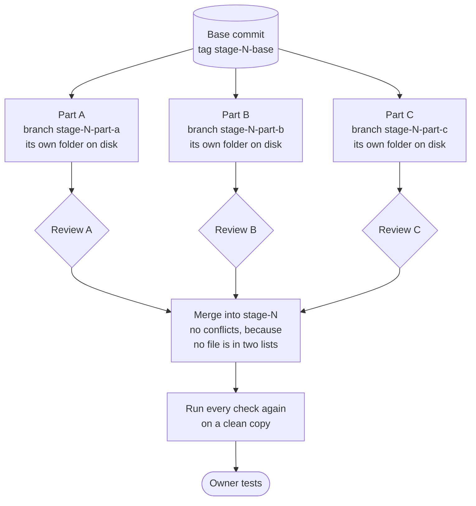
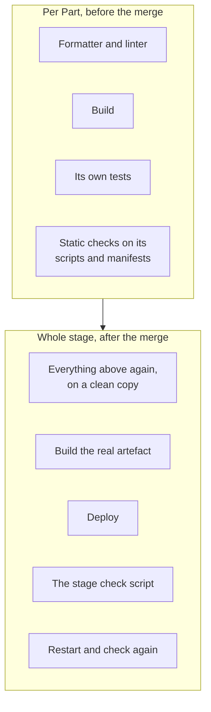

# Chapter 4: Splitting work into Parts

One AI builder is fast. Four working at the same time are faster, but only if they never trip over each other. This chapter shows how to split one stage spec into **Parts** so that several builders can work in parallel and their work merges cleanly.

- **Template:** section 7 and 8 of [`templates/stage-spec.md`](../templates/stage-spec.md)
- **The real examples:** [Stage 1](https://github.com/frozenfussion/open-office-harness/blob/main/docs/specs/stage-1-control-centre.md) (two Parts) and [Stage 2](https://github.com/frozenfussion/open-office-harness/blob/main/docs/specs/stage-2-talk-to-ai.md) (four Parts) of open-office-harness

---

## 4.1 The one rule

> **No Part changes a file another Part lists.**

Everything else in this chapter exists to make that rule possible and to prove it was kept.

Why files, and not "areas" or "features"? Because a file list can be checked by a machine. `git diff --name-only` against the base commit gives the files a Part touched. Compare that with the list in the spec. A Part described as "the back end" cannot be checked that way.



---

## 4.2 When to split, and when not to

| Split when | Do not split when |
|---|---|
| The stage has pieces that meet only through names (a port, a route, a variable, a file format) | The pieces must be designed together as you go |
| Each piece can pass some checks on its own | Nothing can be checked until everything exists |
| The stage would take one builder long enough that waiting hurts | The stage is small. Two builders cost two reviews |
| You can watch that many builders (chapter 5) | You cannot answer their questions quickly |

Every Part adds a review, a fix round and a merge. Two to four Parts is a comfortable range for one person to steer. More is possible, but your attention becomes the limit long before the tools do.

---

## 4.3 Where to cut

Look for a line where the two sides need each other only through an agreed name. Four cuts that work again and again:

| The cut | One side | The other side | They meet at |
|---|---|---|---|
| **Code vs. getting it running** | The program and its tests | Build pipeline, deployment files, install and check scripts | The image name, the port, the environment variable names |
| **Service vs. service** | Service A | Service B | The contract between them (an API description, a message schema) |
| **Back end vs. front end** | The API | The app that calls it | The API description |
| **Product vs. proof** | The thing | The script that proves the stage works | The routes and the expected answers |

**The real example, two Parts.** Stage 1 built one service. The spec cut it as code versus getting it running:

| | Part A | Part B |
|---|---|---|
| Owns | The service's source folder, its tests, its Dockerfile, its API description | The image build workflow, deployment manifests, four install and check scripts, two documentation files |
| Meets the other at | Port 8080, seven environment variable names, the image name and tag format | The same, from the other side |

**The real example, four Parts.** Stage 2 built two new services and two web apps and changed an existing service. The spec cut it as service versus service, and gave the stage's check script to one of them:

| Part | Owns | Builder's window |
|---|---|---|
| A | The Model Gateway service, with its own workflow, manifests and scripts | 0 |
| B | The Harness API service, the same way | 1 |
| C | The Workspace web app, the platform glue, **and the check script for the whole stage** | 4 |
| D | Changes to the existing Control Centre, and the Admin Console web app | 5 |

Notice that in Stage 2 each Part carries its own "getting it running" files. That is the better cut once you have several services: each Part is a complete vertical slice, and the builders meet only at the contracts.

---

## 4.4 Writing a Part

Each Part in the spec has five things.

**1. A heading that says who and where.**

```
### Part A: <name> (branch `stage-N-part-a`, Builder A, window 0)
```

**2. "Files (only these)".** A literal list. Use `**` for a whole folder the Part owns. Next to any file that already exists, say in brackets exactly what changes.

```
services/reminders/**            (package, tests, Dockerfile, README.md, lock file)
contracts/http/reminders.yaml
install/30-platform-apply.sh     (stop applying the placeholder; nothing else changes)
```

The bracketed note on the last line matters. A builder allowed to edit an existing script will "improve" it unless told the limit.

**3. What to build.** Numbered, pointing at the spec's decisions, data model and interfaces instead of repeating them.

**4. What the tests must cover.** By name. "Tests for the service" produces three happy-path tests. A list produces the list.

**5. "Part done when".** The checks *this Part can pass alone*. This is where split specs most often go wrong, and it gets its own section below.

**The real example.** Stage 2 Part A's test line is one long sentence naming more than a dozen behaviours, including:

> main → backup before first output, no failover after first output, rate limit skip, budget skip, cost maths, [...] the key never logged (a test captures logs) [...]

The builder's report for that Part lists 129 tests. A list in the spec is what gets you from three tests to that.

---

## 4.5 Files that two Parts both need

Sooner or later two Parts need the same file. There are four ways out. Pick one, and write it in the spec.

| Way out | When to use it |
|---|---|
| **Give the file to one Part**, and have the other Part ask through the planner | The change is small and one-sided |
| **Split the file** so each Part has its own | An index or registry that every Part adds to |
| **Make it the planner's file**: written into the spec before the build, changed by nobody | Shared contracts and schemas |
| **Write it at merge**, by whoever merges, and by nobody before | A status file or changelog that describes the whole stage |

**The real example of splitting a file.** The project keeps an index of all its API examples in one file, `contracts/examples/index.json`. In Stage 2, four Parts all needed to add examples. The spec gave Part A its own index file instead:

> `contracts/examples/index.model-gateway.json` (index entries for NEW Gateway examples; existing entries stay in index.json, whose example files Part A may update in place)

**The real example of writing at merge.** The Stage 1 spec says of the merge step:

> [...] writes `docs/STATUS.md` (the only file written at merge).

**The real example of the planner's files.** Every spec has a section listing files that already exist and that no builder changes: the rules file, the specs, the plan, and everything from earlier stages that no Part lists.

---

## 4.6 The names the Parts must share

Two builders working at the same time cannot talk to each other. Whatever both must spell the same way goes into one table in the spec, "Fixed names between the Parts".

What belongs in it:

- ports, and which path answers a health check;
- names of images, packages and their tag format;
- every environment variable, and where its value comes from;
- names of secrets and the keys inside them;
- service, database and queue names;
- file paths that one Part writes and another reads;
- the shape of any config file one Part produces and another consumes.

**The real example.** In Stage 2 this table has rows for ports, images, each service's environment variables, test settings files, the web apps' config file and how secrets are handled. One row gives the web config file's exact shape, as JSON, because one Part writes that file and two apps read it.

**Test for completeness:** for every place where one Part's output is another Part's input, is the exact name in the table? If you find yourself writing "the usual name", it is not.

---

## 4.7 A "done when" each Part can pass alone

This is the trap. If Part A's finish line needs Part B's work, then Part A can never truthfully say it is finished, and it will either wait, or fake it.

**The rule.** Give each Part checks it can pass with only its own files: build, format, lint, unit tests, static checks on its manifests and scripts. Put everything that needs the whole stage together into the stage's own "Done when", which runs after the merge.



**The real example of getting it wrong.** The first version of the Stage 1 spec asked Part B (getting it running) to finish with a live deployment. But the image could only be built from Part A's code, and Part A was on another branch. Nobody saw it in two spec reviews. It surfaced when Builder B asked the planner for Part A's image tag. The fix is recorded in the spec's change table:

> Part B ends with static checks only. The live run [...] happens after Codex merges both Parts into `stage-1`: the image workflow (Part B) and the Control Centre code (Part A) are on different branches, so no image can exist before the merge.

Three lessons in that one entry: write per-Part finish lines that need nothing from another Part; expect at least one gap like this in any split; and make sure builders stop and ask, because that is how it was caught in minutes.

---

## 4.8 One folder per builder: git worktrees

Two builders cannot share one working folder. One would switch branches under the other. A **git worktree** gives each builder its own folder, on its own branch, backed by the same repository.

```
~/projects/
  my-product/                  the main clone (main branch)
  worktrees/
    stage-2-part-a/            Builder A works here, on branch stage-2-part-a
    stage-2-part-b/            Builder B works here, on branch stage-2-part-b
    stage-2/                   the merged stage, made after review
```

The commands, with what each does:

```bash
# Mark the commit every Part starts from.
git -C ~/projects/my-product tag -a stage-2-base -m "Stage 2 base"
git -C ~/projects/my-product push origin stage-2-base

# Make Builder A's folder and branch, starting at that commit.
git -C ~/projects/my-product worktree add ~/projects/worktrees/stage-2-part-a -b stage-2-part-a stage-2-base

# Make Builder B's folder and branch, the same way.
git -C ~/projects/my-product worktree add ~/projects/worktrees/stage-2-part-b -b stage-2-part-b stage-2-base

# See all folders and their branches.
git -C ~/projects/my-product worktree list
```

Start each builder inside its own folder. Its first instruction is: read the rules file, read the spec, build only your Part.

**The real example.** The rules file gives the worktree command once, with placeholders, in its build flow section, so that every stage and every builder lays its folders out the same way. The spec then only has to name the branch.

---

## 4.9 When a builder needs something from another Part

It will happen. The rule is the same every time:

1. **The builder stops and asks the planner.** It does not edit the other Part's file, and it does not invent a name.
2. **The planner decides**, and if the answer changes what any Part builds, **writes it into the spec's change table** with the time and who asked.
3. **The planner tells every Part the change affects.** A change that only one builder hears about is a merge failure waiting to happen.

**The real example.** In the first half hour of the Stage 2 build, four entries went into the spec's change table from builder questions. One of them:

> Conversation paging: `GET /api/conversations?before=<conversation id>` [...]. Parts B and C both use it | Spec author, 10 Nov 14:13 (B) and 14:21 (C)

Builder B (the API) and Builder C (the app that calls it) each asked about paging, eight minutes apart. The planner made one decision, wrote it down once, and both built to it. Without a planner in the middle, you would have had two paging schemes and found out at the merge.

---

## 4.10 Merging

After every Part has passed review:

```bash
# A folder and branch for the merged stage, from the same base commit.
git -C ~/projects/my-product worktree add ~/projects/worktrees/stage-2 -b stage-2 stage-2-base

cd ~/projects/worktrees/stage-2
git merge --no-ff stage-2-part-a      # brings in Part A
git merge --no-ff stage-2-part-b      # brings in Part B
```

If the file lists truly did not overlap, there are no conflicts. **A merge conflict is a finding**: it means a Part changed a file it did not own. Do not resolve it by hand and move on. Find out which Part crossed the line, and why the review missed it.

Then, on the merged branch, in a clean copy:

1. Run every check from the stage's "Done when" that needs no live system.
2. Write the status file entry (chapter 7).
3. Hand over to the owner for the live checks.

Only after the owner says "accepted" does the stage branch go to main, with a tag.

---

## 4.11 Proving the rule was kept

Give the reviewer these, per Part:

```bash
cd ~/projects/worktrees/stage-2-part-a

# Every file this Part touched since the base commit.
git diff --name-only stage-2-base...HEAD

# Is the folder clean (nothing left uncommitted)?
git status --short
```

The reviewer compares the first list with the spec's "Files (only these)". Anything extra is a finding. It is item 2 on the review checklist in the real project:

> Did the Part change any file it does not list? (Must be none.)

And a real review of Stage 1 Part B opens its results with exactly this:

> Every changed file is in Part B's list.

---

## 4.12 Common mistakes

| Mistake | What it causes | Do this instead |
|---|---|---|
| Parts described by topic | Two builders edit the same file | A literal file list per Part |
| A shared "common" folder | Everyone edits it | Each package stands alone unless a spec creates a shared one |
| No "fixed names" table | Parts that pass alone and fail together | One table for every shared name |
| A Part's finish line needs another Part | Waiting, or faking | Per-Part checks that need only its own files |
| Builders answering each other's questions | Two versions of the truth | Everything through the planner, and into the spec |
| Resolving a merge conflict by hand | A crossed boundary goes unnoticed | Treat the conflict as a finding |
| Builders in the same folder | Branches switched under each other | One worktree per builder |
| Too many Parts | You cannot steer them | Two to four |

---

## 4.13 Checklist

- [ ] The cut runs along a line where the sides meet only through names.
- [ ] Every Part has a branch name, a builder and a literal file list.
- [ ] No file appears in two lists. Shared files are split, owned by one Part, owned by the planner, or written at merge.
- [ ] Existing files a Part may edit carry a note saying exactly what changes.
- [ ] Every shared name is in the "fixed names" table.
- [ ] Each Part's "done when" needs only its own files.
- [ ] The whole-stage checks run after the merge.
- [ ] Every builder has its own worktree, made from the base tag.
- [ ] Cross-Part questions go to the planner, and answers go into the spec.
- [ ] The merge has no conflicts, and the file lists were checked with `git diff --name-only`.

---

**Next:** [Chapter 5, running several agents](05-running-several-agents.md).
