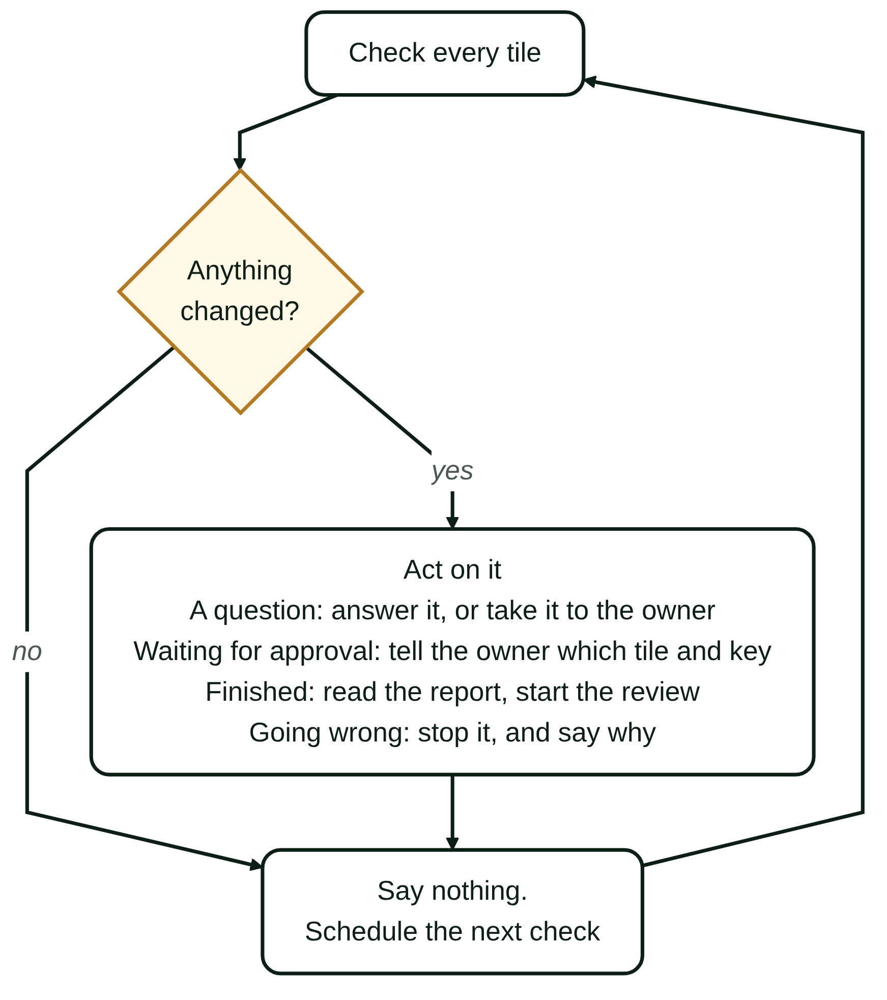

# Chapter 5: Running several agents

You have a spec split into Parts. Now several AI agents must run at the same time, for a long time, on a machine you may not be sitting at, and you must be able to see every one of them, step in, and approve or refuse. This chapter shows the setup I use: one remote machine, one `tmux` session, one tile per agent.

- **Template:** [`templates/tmux-work.sh`](../templates/tmux-work.sh)
- **The real example:** the build of [open-office-harness](https://github.com/frozenfussion/open-office-harness), which ran four builders, a reviewer and a shell side by side

---

## 5.1 What you need from the setup

| Need | Why |
|---|---|
| **See** every agent at once | You cannot steer what you cannot see. An agent going wrong is obvious within seconds if it is on screen |
| **Reroute** any agent at any moment | Type into its tile, or stop it |
| **Approve** or refuse what needs you | Agents ask before risky actions; someone must answer |
| Sessions that **survive** a dropped connection | A build takes hours. Your laptop will sleep |
| A place for **your own** commands | The privileged ones only you may run |
| Agents kept **apart** | Each in its own folder and branch (chapter 4) |

`tmux` gives you all of this in a plain terminal, on any Linux or macOS machine, with nothing else to install.

---

## 5.2 The layout

```
 Owner (laptop or phone, over SSH): attaches, watches, types
 Planner AI (its own SSH key): reads tiles, types commands
                         |
                         v
+----------------- tmux session "work" on the build machine -----------------+
| 0: BUILDER A                         | 1: BUILDER B                        |
|    folder: stage-N-part-a            |    folder: stage-N-part-b           |
|    builds Part A only                |    builds Part B only               |
|                                      |                                     |
+--------------------------------------+-------------------------------------+
| 2: REVIEWER                          | 3: SHELL (owner)                    |
|    a fresh session for every review  |    the owner's own commands,        |
|    changes nothing                   |    including the privileged ones    |
|                                      |                                     |
+--------------------------------------+-------------------------------------+
```

One session, one window, one **tile** (tmux calls it a pane) per job. Every tile has a title on its border, so you always know who is who.

**The real example.** The project's rules file fixes the layout in its "places and names" section, so every agent and every document refers to tiles the same way:

> Everyone works inside the tmux session `harness`, window `work`, labelled tiles: 0 Codex A (builds), 1 Codex B (builds), 2 Claude Code (reviews), 3 Shell (Aziz, sudo), and from Stage 2 also 4 Codex C (builds), 5 Codex D (builds).

Because the tile numbers are in the rules, a spec can say "Part C, tile 4" and an instruction to the owner can say "click tile 3 and press Enter". Nobody has to describe where things are.

---

## 5.3 Why a remote machine

Run the agents on a server (a small cloud machine is enough), and connect to it from your laptop.

| Reason | What it means in practice |
|---|---|
| **A sandbox** | The agents can only reach what is on that machine. Your laptop, your documents and your other credentials are somewhere else |
| **It stays on** | Close the laptop; the build continues |
| **It is where the product runs** | Builders test against the real database and the real cluster, not a mock |
| **Anyone can attach** | You, from a phone. A colleague, to watch |

---

## 5.4 tmux in five minutes

Everything in tmux starts with a **prefix**: press `Ctrl+b`, release, then press one more key.

| Keys | What it does |
|---|---|
| `Ctrl+b` then `d` | Detach: leave everything running and return to the normal terminal |
| `Ctrl+b` then an arrow key | Move to the tile in that direction |
| `Ctrl+b` then `q` | Flash each tile's number; press a number to jump to it |
| `Ctrl+b` then `z` | Zoom the current tile to full screen; the same keys again to zoom back |
| `Ctrl+b` then `[` | Scroll mode: arrow keys or Page Up to read back; `q` to leave |
| `Ctrl+b` then a number | Switch to that window, if you use more than one |

And from the normal terminal:

```bash
tmux attach -t work        # Come back to the session named "work".
tmux ls                    # List sessions.
```

With mouse support switched on (the script below does it) you can also click a tile to select it and scroll with the wheel.

---

## 5.5 Building the layout with one script

Type this in a terminal on the build machine. The folder does not matter. It asks for no password. It makes a session named `work` with four titled tiles and attaches to it. Running it again when the session exists simply attaches.

```bash
#!/usr/bin/env bash
# tmux-work.sh: one window, four titled tiles.
set -euo pipefail
S=work

if tmux has-session -t "$S" 2>/dev/null; then
  exec tmux attach -t "$S"
fi

tmux new-session -d -s "$S" -n work          # tile 0
tmux split-window -h -t "$S":work            # tile 1, to the right
tmux split-window -v -t "$S":work.0          # a tile under tile 0
tmux split-window -v -t "$S":work.2          # a tile under the right one
tmux select-layout -t "$S":work tiled        # four equal tiles

# Titles on the borders, and mouse support.
tmux set-option -t "$S" pane-border-status top
tmux set-option -t "$S" pane-border-format " #{pane_index}: #{pane_title} "
tmux set-option -t "$S" mouse on
tmux set-option -t "$S" history-limit 50000
# Stop programs from renaming the tiles.
tmux set-option -w -t "$S":work allow-rename off

tmux select-pane -t "$S":work.0 -T "BUILDER A"
tmux select-pane -t "$S":work.1 -T "BUILDER B"
tmux select-pane -t "$S":work.2 -T "REVIEWER"
tmux select-pane -t "$S":work.3 -T "SHELL (owner)"

tmux select-pane -t "$S":work.3
exec tmux attach -t "$S"
```

After `select-layout tiled`, check the numbers with `Ctrl+b` then `q`: tmux numbers tiles by position, left to right, top to bottom. The titles are set by number after the layout, so they always match what you see.

To add two more builders later, without disturbing the existing tiles:

```bash
tmux split-window -t work:work
tmux split-window -t work:work
tmux select-layout -t work:work tiled
tmux select-pane -t work:work.4 -T "BUILDER C"
tmux select-pane -t work:work.5 -T "BUILDER D"
```

**The real example.** That is what happened at the start of Stage 2. The spec's prerequisites say:

> Two more tmux tiles: tile 4 "CODEX C, builds" and tile 5 "CODEX D, builds" (Claude adds them; tiles 0–3 keep their numbers and roles).

The last bracket is the important part. Tile numbers are in documents and in people's heads by then. Adding is fine; renumbering is not.

---

## 5.6 Starting each agent

In each builder's tile, go to that builder's own folder and start the agent there:

```bash
# In tile 0.
cd ~/projects/worktrees/stage-2-part-a
<your agent's command>
```

Then give it its first instruction. Keep it the same shape for every builder:

```
You are Builder A for Stage 2.
Read AGENTS.md, then docs/specs/00-GLOBAL-RULES.md, then docs/specs/stage-2-<name>.md.
Build only Part A. Change only the files Part A lists.
If anything is unclear or you need a file you do not own, stop and ask.
When all of Part A's checks pass, commit on your branch and write your report
in the format in section 7 of the rules.
```

The reviewer's tile gets a **new session for every review**, started in the folder of the Part under review. A reviewer that remembers the last review brings its conclusions with it.

Tile 3 is a plain shell and belongs to the owner. Privileged commands are typed there and nowhere else.

---

## 5.7 Permissions: how much each agent may do without asking

Every coding agent has a setting for what it may do without your approval. The names differ by tool; the levels are roughly these.

| Level | The agent may | Use it for |
|---|---|---|
| **Ask for everything** | Read; asks before every command or edit | The first hour with a new tool or a new kind of task |
| **Edit freely, ask for commands** | Edit files in its folder; asks before running commands | Careful work near anything shared |
| **Work freely inside its folder** | Edit and run inside its worktree; asks before reaching outside or onto the network | A normal build on a sandbox machine |
| **No questions** | Anything the machine allows | Only on a machine where the worst case is acceptable, and only by the owner's decision |

Three rules, whatever the tool:

1. **The level is the owner's decision**, per stage, and it is written down.
2. **The rules file still applies at every level.** "No questions" removes the prompts. It does not remove the "never" list. The reviewer checks the list afterwards (chapter 6).
3. **One agent never approves another agent's prompt.** If the planner can type into a builder's tile, it may type instructions. It may not press "yes" on a permission prompt. That key is the owner's.

**The real example.** The project started with builders that asked. After the first stage had been merged and the owner had watched how they behaved, he chose the widest level for them. The decision sits in the Stage 2 spec, with the time:

> Four Codex windows at the same time, each in its own worktree from `stage-2-base`, Full Access (Aziz 13:41).

And the third rule was not theory. The planner in that build refused, by its own safety rules, to answer a builder's approval prompt or to start a full-access builder itself. The instruction to the owner was always the same shape: which tile to click and which key to press.

---

## 5.8 The planner can read and type, too

If your planner AI can reach the build machine (over SSH, with its own key), two tmux commands make it far more useful.

**Reading a tile**, to see what an agent is doing or has reported:

```bash
# The last 200 lines of tile 0, as text.
tmux capture-pane -p -t work:work.0 -S -200
```

**Typing into a tile**, for example into the owner's shell so the owner only has to press Enter:

```bash
# Type a command into tile 3, without pressing Enter.
tmux send-keys -t work:work.3 'bash install/70-check-stage-2.sh'

# Press Enter in tile 3 (only when the owner has said so, or the command is safe).
tmux send-keys -t work:work.3 Enter
```

The first of those two is the pattern I use most: **the planner types the command where the owner can see it, and the owner presses Enter.** The owner reads exactly what will run, in the terminal where it will run, and nothing has to be copied or pasted. It also works when the owner is on a phone.

A longer message to an agent is better loaded from a file than typed key by key:

```bash
tmux load-buffer -b msg /tmp/fix-request.md     # Put the file's text into a tmux buffer.
tmux paste-buffer -b msg -t work:work.0         # Paste it into tile 0.
tmux send-keys -t work:work.0 Enter             # Send it.
```

**Rules for a planner that drives the terminal.**

| Rule | Why |
|---|---|
| Announce before acting: what, in which tile, why | The owner should never be surprised by text appearing |
| Give the planner its own SSH key, added by the owner | It can be removed in one line; it is never the owner's key |
| Type; do not press Enter on anything that changes a shared system | The owner's Enter is the approval |
| Never type into a permission prompt | See 5.7 |
| Read the tile back afterwards and report what actually happened | "I sent it" is not "it worked" |

**The real example.** In the build, the planner had its own key on the build machine. It installed and signed in the builder tool by typing into a tile while the owner watched, and read the screen back with `tmux capture-pane` to confirm each step. From Stage 2 the rules file says the planner runs the non-privileged deploy and check scripts "in his shell tile where he watches".

---

## 5.9 Watching without staring

Several agents can run for an hour. You do not have to watch every line, but nobody may be left waiting.

<p align="center"></p>

What to look for in a tile:

| You see | It means | Do |
|---|---|---|
| Output scrolling | Working | Nothing |
| A question, cursor waiting | Blocked on you | Answer through the planner, and record the answer in the spec if it changes anything |
| A yes/no prompt | Wants approval | The owner decides |
| The same error repeating | Stuck in a loop | Stop it, read back, give it the missing fact |
| Edits to files outside its list | Crossing the fence | Stop it at once |
| A report | Finished | Review |
| Nothing for a long time | Finished, crashed, or waiting silently | Read back with `Ctrl+b` then `[` |

If the planner AI does the watching, give it a rhythm and three rules: schedule the next check *before* doing anything else, say when the next check is, and speak only when something changed. An AI that reports "still running" every minute trains you to ignore it.

**The real example.** The owner watched the tiles himself, and the planner checked them every minute on a timer. The standing rule, in the owner's words, became: reschedule the next check first, state the next check time in every update, speak only on change, and send an email when the owner is away and needed.

---

## 5.10 Stepping in

| You want to | Do this |
|---|---|
| Say something to an agent | Click its tile and type |
| Interrupt what it is doing | Click its tile and press `Esc` (most agent tools) or `Ctrl+c` |
| Read what it did earlier | `Ctrl+b` then `[`, scroll, `q` |
| See one tile large | `Ctrl+b` then `z` |
| Stop an agent completely | Interrupt it, then leave the tool with its quit command |
| Throw away a Part and start again | Stop the agent, then reset its branch to the base tag in its worktree |

Stopping an agent early is cheap. An agent that has gone down the wrong road for twenty minutes has usually built on its mistake, and the fix is harder than a restart.

---

## 5.11 After a reboot

A tmux session lives in memory. Restart the machine and it is gone. The work is not: every branch, worktree and commit is on disk.

1. Connect to the machine.
2. Run the layout script again (5.5).
3. In each builder's tile, `cd` to its worktree, start the agent, and tell it to read the rules, the spec and its own `git log` and `git status` before continuing.

**The real example.** Every stage's acceptance included a reboot, to prove the product came back by itself. The instructor notes for those stages carry the same line each time: after a reboot the tmux session is gone, the planner rebuilds the tiles, and the owner only types the attach command.

---

## 5.12 Common mistakes

| Mistake | What it causes | Do this instead |
|---|---|---|
| Agents in separate terminal windows on a laptop | You watch one and miss three; they die when the lid closes | One tmux session on a server |
| Untitled tiles | Instructions typed into the wrong agent | Titles on every border; numbers fixed in the rules |
| Two agents in one folder | Branches switched under each other | One worktree per agent |
| Running privileged commands in an agent's tile | An agent sees or reuses a password | One shell tile that is only the owner's |
| Widest permissions on day one | You find out what the agent does by accident | Start narrow; widen by decision |
| One agent approving another's prompt | No human in the loop | Approval keys belong to the owner |
| Reusing the reviewer's session | A reviewer that already "knows" the answer | Fresh session per review |
| Letting an agent run on when it is clearly lost | A branch built on a mistake | Stop early |

---

## 5.13 Checklist

- [ ] The agents run on a machine that is not your laptop.
- [ ] One tmux session, one titled tile per agent, plus one shell tile for the owner.
- [ ] The tile numbers and roles are written in the rules file.
- [ ] Each builder is started inside its own worktree.
- [ ] Each builder got the same first instruction: rules, spec, your Part only, stop and ask.
- [ ] The permission level is the owner's decision and is written down.
- [ ] Nobody but the owner answers an approval prompt.
- [ ] If the planner drives the terminal: its own key, announce first, type but do not press Enter on shared changes, read back.
- [ ] Someone checks every tile on a rhythm, and speaks only on change.
- [ ] The layout script exists, so a reboot costs one command.

---

**Next:** [Chapter 6, reports and review](06-reports-and-review.md).
