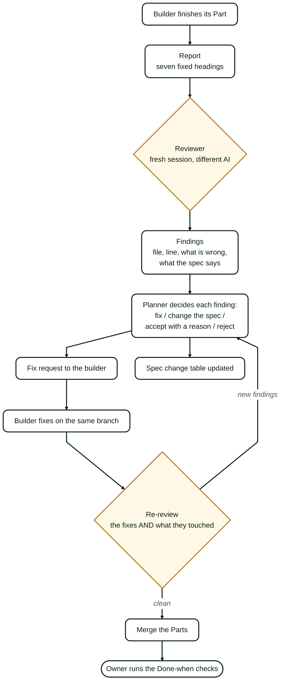

# Chapter 6: Reports and review

A builder says "done". This chapter is about what happens between that word and the moment the owner tests: a **report** in a fixed format, a **review** by a different AI that lists findings only, the planner's **decisions** on each finding, a **fix round**, and a **re-review**.

- **Templates:** [`builder-report.md`](../templates/builder-report.md), [`review-request.md`](../templates/review-request.md), [`fix-request.md`](../templates/fix-request.md)
- **The real example:** the report format and review checklist in sections 7 and 8 of the [rules file](https://github.com/frozenfussion/open-office-harness/blob/main/docs/specs/00-GLOBAL-RULES.md) of open-office-harness, and reviews from its build

---

## 6.1 The cycle

<p align="center"></p>

Each arrow is a document. That is what lets you stop at any point, come back tomorrow, and know exactly where things stand.

---

## 6.2 The builder's report

**The rule.** Every Part ends with a report under the same headings, in the same order. The format lives in the rules file, so no builder has to be told twice.

```
STAGE N PART X REPORT
1. Built: <files and folders added or changed, one line each>
2. Dependencies added: <name, exact version, why> (or "none")
3. Checks run and results: <each check, passed or failed, with counts>
4. Things I could not do (needed privileges / the live system / network / a decision): <list>
5. Deviations from the spec: <none, or each one with the reason>
6. Open questions for the owner: <one per line, plain words, why it matters>
7. For the guide: <what the owner ran, what they should see, what failed and the fix, time taken>
```

**What each heading is for.**

| Heading | Who uses it | What it prevents |
|---|---|---|
| **Built** | The reviewer compares it with the file list | A summary that hides what was touched |
| **Dependencies added** | The reviewer checks each against the lock file and the "why" | Packages slipping in unnoticed |
| **Checks run** | The reviewer re-runs them; the planner sees what was *not* run | "All tests pass" with no number behind it |
| **Could not do** | The planner and the owner | Silent gaps. This heading makes "I skipped it" an allowed, visible answer |
| **Deviations** | The planner decides each one | A builder quietly knowing better than the spec |
| **Open questions** | The owner | Guesses |
| **For the guide** | Whoever writes the user or instructor guide | Documentation rebuilt from memory |

Headings 4, 5 and 6 are the valuable ones. They give the builder three honest places to put anything that did not go to plan. Without them, the only way to finish is to say everything is fine.

**How to read a report.** A report is the builder's *claim*. Treat it as a list of things to check, never as evidence.

**The real example.** The start of a real report from Stage 2:

> STAGE 2 PART A REPORT
>
> 1. Built:
>    - services/model-gateway/: validated HTTP routes, identity, registry/key/token caches, three adapters, failover, limits, costs, append-only migration, 129 tests, locked package, container and Quick Guide.
>    - [...]
>    - install/64-model-gateway-setup.sh: re-runnable database and secret setup, committed/pushed FIRST as 1c0f8fe.
>
> 2. Dependencies added:
>    - annotated-doc 0.0.5: FastAPI documentation annotations.
>    - [...]

Two things to notice. It gives a commit hash for a file another step was waiting on. And the dependency list goes down to packages pulled in indirectly, each with a version and a reason, because the rules say *every* new dependency.

---

## 6.3 Who reviews

**The rule.** The reviewer is a different session from the builder, and from the planner. Where you can, use a different model as well.

| Arrangement | Good enough? |
|---|---|
| The builder reviews its own work in the same session | No. It will confirm what it believes |
| The same tool, a brand-new session, given only the spec, the rules and the branch | Yes. The minimum |
| A different tool or model, a new session | Better. Different blind spots |
| Two reviewers for a risky stage | Worth it for security, money or data |

Start a new reviewer session for every review, including the re-review. A reviewer that carries its earlier conclusions forward will read the fix as it expects it to be.

---

## 6.4 The review checklist

**The rule.** A numbered list in the rules file. Every item is a yes/no question about something the reviewer can run or see. The reviewer goes through all of it, every time.

A checklist for any project has four kinds of question:

| Kind | Examples |
|---|---|
| **Did it do what was asked?** | Does every "done when" item exist and work? Run the checks yourself. Is the documentation updated? |
| **Did it stay inside the fence?** | Any file changed that the Part does not list? Anything built that the spec did not ask for? Any privileged or shared-system change? |
| **Did it keep the project's rules?** | Secrets or personal data anywhere? Versions pinned? Dependencies justified? Tests on every route? |
| **Did it avoid our known traps?** | One item for each thing that has bitten this project before |

**The real example.** The project's checklist has fourteen items. Some of them:

> 1. Does every item in the Part's "Done when" exist and work? Run the checks yourself where possible.
> 2. Did the Part change any file it does not list? (Must be none.)
> 4. Any model name, vendor, address, key, token or secret in code, config, manifests or docs? (Must be none.)
> 10. Any script that pipes into `head`/`grep -q` under `pipefail`, is not re-runnable, or lacks `STOP:`/`DONE`?
> 14. Anything built that the spec did not ask for?

Item 10 is the "known trap" kind: it mirrors a code rule that exists because of a past failure (chapter 2). Item 14 is the last line of defence against scope creep.

And the instruction for the output:

> Report findings as a numbered list: file, line, what is wrong, what the spec says. No praise, no summary of what is fine.

---

## 6.5 Asking for a review

Give the reviewer a short, fixed request. It needs to know where to look and what shape to answer in.

```
You are the reviewer for Stage N Part X. This is a new session; assume nothing.

Read, in this order:
1. docs/specs/00-GLOBAL-RULES.md (section 8 is your checklist)
2. docs/specs/stage-N-<name>.md (the whole spec, including the change table at the end)
3. The builder's report: <path>

The work is on branch stage-N-part-x, in <worktree path>, starting from tag stage-N-base.
Change nothing. Do not fix anything.

First, list the checks you ran yourself and their results.
Then report findings as a numbered list: file, line, what is wrong, what the spec or rule says.
No praise, no summary of what is fine. If you could not check something, say so.
Write the result to <path>.
```

Four phrases do most of the work:

- **"Assume nothing"** keeps it from trusting the report.
- **"Change nothing"** keeps the reviewer a reviewer. A reviewer that fixes things produces unreviewed code.
- **"List the checks you ran"** shows you what the review actually rests on.
- **"If you could not check something, say so"** gives it an honest way out, just like the report's heading 4.

---

## 6.6 What a good review looks like

**The real example.** A review of Stage 1 Part B begins with the checks the reviewer ran, each with its result:

> Checks I ran in ~/projects/worktrees/stage-1-part-b:
> - `bash -n install/*.sh`: clean.
> - `shellcheck install/*.sh`: clean.
> - `kubeconform -strict` on `deploy/`: 51 resources, 22 valid, 0 invalid, 29 skipped [...].
> - Workflow YAML parses. actionlint is not installed on harness, so it was not run. [...]
> - Every changed file is in Part B's list. No secrets, model names or personal data were found.

Read the fourth line again. The reviewer says what it did *not* run and why. That sentence is worth more than a dozen "all good" lines, because it tells you where the review's knowledge ends.

It also says what it checked across the Part boundary: that the paths and fields used by Part B's scripts match the API description on Part A's branch. Nobody asked it to; the spec's "fixed names" made it checkable.

Then the findings. The first one names nine files with line numbers and one problem: values that an earlier stage had made into placeholders were written out literally in the new files. Nine findings in all.

**What makes a finding useful:**

| Part | Example |
|---|---|
| **Where** | `install/61-control-centre-deploy.sh:162` |
| **What is wrong** | The namespace is written literally |
| **What the spec or rule says** | Earlier stages render it from the values file, so the same files work on the next environment |
| **Why it matters** (when not obvious) | The files are meant to work unchanged on the next environment |

A finding without "what the spec says" is an opinion. It may still be right, but the planner has to decide it.

---

## 6.7 The planner decides every finding

A review is advice. Somebody has to rule on it, and that is the planner, with the owner for anything that is really a decision.

Each finding gets one of four answers:

| Answer | When | What follows |
|---|---|---|
| **Fix** | The finding is right and the spec is right | Into the fix request |
| **Change the spec** | The finding is right because the spec was wrong or silent | The spec's change table gets an entry; then fix to the new text |
| **Accept, with a reason** | It breaks a rule, knowingly, for a reason that holds | Written down as an accepted exception with its limit; the owner agrees if a global rule is bent |
| **Reject** | The reviewer misread, or it is taste | One line saying why, so the next reviewer does not raise it again |

**Never pass raw findings straight to the builder.** A builder given nine findings will "fix" all nine, including the two that were the spec's fault and the one that was wrong.

**The fix request** puts the decisions first:

```
# Stage N Part X: fixes after review (planner's decisions first)

Read <path to review> (<count> findings). Fix findings <list> on branch stage-N-part-x.
Finding <n> is the planner's (the spec is being updated).

## Decisions
- D1 (finding 1): yes. <exactly what to do>
- D2 (finding 2): <the decision, and the new wording of the spec item it changes>
- D3 (finding 4): <...>

## Rules for this round
- Change only what these findings need. No other improvements.
- Add or adjust tests for each fix.
- End with a short report: each finding, what you changed, which checks you re-ran.
```

**The real example.** The fix request for that same review opens:

> Read /tmp/stage-1-part-b-review.md (9 findings). Fix findings 1-8 on stage-1-part-b. Finding 9 is the spec author's (spec section 14 is being updated in a separate pull request).

and then gives a numbered decision for each. The first:

> D-B1 (finding 1): yes: same placeholders as Stage 0 [...] from deploy/values/do.env; [three scripts] render before kubectl apply as [the earlier script] does [...].

One finding (number 2) led to one of the spec's own checks being rewritten. The decision says so: "Spec section 2 item 3i is reworded to match." The decisions then appear, in summary, as an entry in the spec's change table, with the name of the file that holds the detail.

---

## 6.8 The re-review

**The rule.** After the fixes, a new reviewer session checks two things: that each finding is really fixed, and that the fixes did not break or add anything.

Fixes are new code, written quickly, under less scrutiny than the original. They are where mistakes hide.

**The real numbers.**

| What was reviewed | First review | Re-review |
|---|---|---|
| Stage 1 spec | 30 findings | 8 new ones, from the fixes |
| Stage 2 spec | 38 findings | 37 fixed, 8 new small ones, then a final check |

Some Parts in the real build needed a second re-review. That is normal. Stop when a review comes back clean, not when you are tired of reviewing.

---

## 6.9 Reviewing the spec, too

Everything above also applies before the build, with the spec as the thing under review (chapter 3, section 3.20). The cycle is the same: findings, the planner's decisions, fixes, re-review, and a record in the spec's change table.

If you only have time for one review, review the spec. It is the cheapest place to find a mistake.

---

## 6.10 After the Parts are clean

1. **Merge** the Parts into the stage branch (chapter 4).
2. **Run every static check again** on a clean copy of the merged branch.
3. For a risky stage, a **final review of the merged result**: does the whole satisfy the spec's "Done when"?
4. **The owner deploys and runs the checks.**
5. Anything found in the live run is fixed the same way: a decision, a fix, a check, and a line in the spec's change table.

**The real example.** Stage 1's live run found four problems that no review had caught, among them the program listening on the wrong port and a system library missing from the small container image. They are entry 9 in the spec's change table. Reviews catch what can be seen by reading and by static checks. Only running the thing shows the rest, which is why the owner's test is a step of its own.

For the stage that put the product on public cloud infrastructure, the spec added one more gate: an independent read-only audit of the live system against the spec, by a reviewer in its own window, which had to find nothing open.

---

## 6.11 Keeping the paper

Save every report, review, fix request and re-review as a file, named so that the order is obvious:

```
reviews/
  stage-1-spec-review.txt
  stage-1-spec-rereview.txt
  stage-1-part-a-review.txt
  stage-1-part-a-fixes.md
  stage-1-part-a-rereview.txt
  stage-1-part-b-review.txt
  stage-1-part-b-fixes.md
  stage-1-part-b-rereview.txt
  stage-1-final-review.txt
```

Those are real file names from the build. They are the evidence behind every entry in a spec's change table, and the best source you will have when you ask "why did we do it this way?"

---

## 6.12 Common mistakes

| Mistake | What it causes | Do this instead |
|---|---|---|
| Free-form "summary of what I did" | Gaps you cannot see | The seven headings, every time |
| Believing the report | Unchecked claims become facts | The reviewer re-runs the checks |
| The builder reviews itself | Confirmation | A different session; a different model if you can |
| A reviewer that also fixes | Unreviewed code | "Change nothing" |
| Reviews that say what is good | Findings buried in praise | Findings only |
| Raw findings handed to the builder | Wrong and spec-level findings get "fixed" | The planner decides each one first |
| No re-review | Broken fixes | A fresh session checks the fixes and their surroundings |
| Fixing during review rounds what nobody found | Scope creep in the fix round | "Change only what these findings need" |
| Throwing the reviews away | No history | Keep them as files, named in order |

---

## 6.13 Checklist

- [ ] The report format is in the rules file and every builder used it.
- [ ] The report has something under "could not do", "deviations" and "open questions", even if it is "none".
- [ ] The reviewer was a new session, told to assume nothing and change nothing.
- [ ] The review lists the checks the reviewer ran, and what it could not check.
- [ ] Every finding has a place, a problem and the rule or spec line it breaks.
- [ ] The planner gave every finding one of the four answers.
- [ ] Spec-level findings are in the spec's change table.
- [ ] The fix request puts decisions first and forbids other changes.
- [ ] A new session re-reviewed the fixes.
- [ ] Every document is saved as a file.

---

**Next:** [Chapter 7, the logging system](07-the-logging-system.md).
