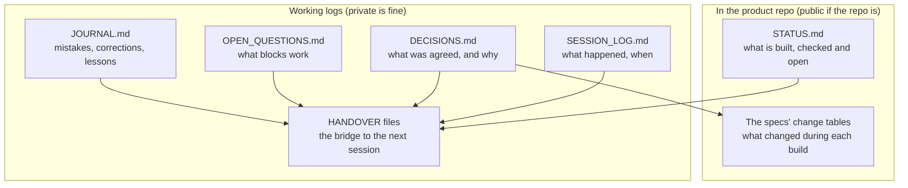
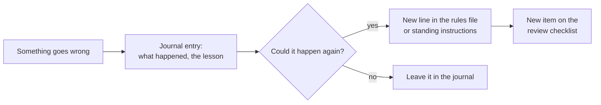

# Chapter 7: The logging system

An AI agent remembers nothing between sessions. A human remembers less than they think. If the only record of a decision is a conversation, that decision is gone the moment the session ends, and the next session will make it again, differently.

The logging system is the project's memory. It is a small set of plain text files, each with one job, written as you go. This chapter is about project logs: what was decided, done, learned and left open. It is not about the log output of your running programs.

- **Templates:** [`templates/STATUS.md`](../templates/STATUS.md) and [`templates/logs/`](../templates/logs/)
- **The real example:** [`docs/STATUS.md`](https://github.com/frozenfussion/open-office-harness/blob/main/docs/STATUS.md) in open-office-harness, and the working logs kept during its build

---

## 7.1 What goes wrong without it

| Without a record of... | This happens |
|---|---|
| Decisions | The same question is argued again next week, and answered differently |
| What was done | "Did we already deploy that?" Nobody knows |
| What was checked | A thing is called working because someone remembers it working |
| What is still open | Known problems are rediscovered by users |
| What went wrong | The same mistake, made by a fresh agent with the same confidence |
| The owner's words | The AI's suggestion slowly becomes "what we agreed" |

---

## 7.2 The files, and the one job each has



| File | Its one job | Shape | Who writes it, when |
|---|---|---|---|
| **STATUS.md** | The truth about the product right now | One section per accepted stage, newest on top | The builder at merge; the planner after acceptance |
| **SESSION_LOG.md** | What happened, in order | Dated, timed bullet lines, oldest first | The planner, every turn where something happened |
| **DECISIONS.md** | What was agreed, and why | A numbered table or numbered sections | The planner, the moment a decision is made |
| **OPEN_QUESTIONS.md** | What is waiting on a human | A small table | The planner |
| **JOURNAL.md** | How the work really went: wrong turns and what fixed them | A numbered table | The planner, when something worth learning happens |
| **HANDOVER** | Everything a new session needs to start | One file per session end | The planner (chapter 8) |

The spec's change table (chapter 3) is part of the same system: it is the log of one stage, kept inside that stage's spec.

**Why separate files?** Because each is read differently. You scan the decisions for one topic. You read the status top to bottom. You read the last twenty lines of the session log. One big file serves none of these.

**The real example.** By the end of the build, the working logs held about 1,100 lines of session log, about 120 numbered decisions, a journal of numbered moves and lessons, and eight handover files. The status file in the repo was 469 lines covering six accepted stages.

---

## 7.3 Five rules for all of them

1. **Append only.** Never rewrite what was written. If something turned out wrong, add a new line that says so and points back. The history of how you got here is the most useful part.
2. **Write it when it happens.** In the same turn, not at the end of the day. Context runs out, sessions crash, and a summary written later is a reconstruction.
3. **Times come from the clock.** Run `date`. An AI's sense of what time it is, is a guess.
4. **Say who.** "The owner, 10 Nov 13:41" is evidence. "It was decided" is not.
5. **Plain words, full names.** The reader is a new session, or you in three months. Write "the check script for Stage 2", not an internal code only today's session knows.

And one more that needs saying twice: **no secrets, ever.** No passwords, tokens or keys in any log, report, commit message or ticket.

---

## 7.4 STATUS.md: the truth about the product

**What it is for.** Anyone, human or agent, should be able to read this one file and know what exists, what was proven, and what is known to be unfinished. Every agent's start file tells it to read this after the rules and the spec.

**Shape.** One section per stage, newest at the top:

```
# Stage N: accepted (<date>)

## Spec
<path>, base tag, acceptance tag

## Merged sources
<branch and final commit of each Part>

## What was built
<short list, by component>

## What was checked
<each check script or command, with counts: "62 PASS, 0 FAIL", and the date>

## Live results
<what the owner ran on the real system and what it showed>

## Changes agreed during the build
<pointer to the spec's change table, with the row numbers>

## Recorded deviations
<anything knowingly different from the spec, with the reason>

## Open for later
<known gaps, each one a plain sentence>
```

**The two sections that matter most.**

- **What was checked**, with numbers and dates. "All checks pass" is a feeling. "199 PASS, 0 FAIL on 12 Nov" is a fact someone can repeat.
- **Open for later.** The honest list. If it is empty after a real build, it is not finished, it is unwritten.

**The real example.** The top of the project's status file, after the cloud copy had been accepted and then deliberately taken down, is not a victory note. It has a section headed:

> Found during the destroy, open for a fix round and review

with four plain items: a teardown script that missed one resource (with the exact command used by hand, and the note that it was run "with Aziz's yes"), a sign-in step that failed in an embedded browser, an expired session whose "cause [is] not known", and a README step that had described the flow wrongly and was corrected.

That is what the file is for. A status file that only records success tells the next session nothing it needs.

---

## 7.5 SESSION_LOG.md: what happened, in order

**What it is for.** The diary. When you ask "what did we do on Tuesday afternoon?" or "when did that change?", the answer is here.

**Shape.** A heading per session or per day, then one line per event, starting with the time.

```
## 2026-03-04, session 7, planner
- 10:14 Owner: reminders go out on day 7 and day 21, never more than two. Logged as decision 31.
- 10:40 Stage 2 spec written and committed as a1b2c3d; tagged stage-2-base.
- 10:52 Spec review started (reviewer, new session). 11:06 back: 12 findings.
- 11:30 Spec fixed; change table rows 1 to 3. Re-review: 2 new, both fixed.
- 11:41 Owner: go. Builders A and B started in their worktrees.
- 12:20 Builder B asked which variable holds the relay address. Answer: SMTP_URL, added to the fixed names table. Told Builder A as well.
- 13:05 NOT DONE: live check, waiting for the owner to run the secrets script.
```

**What makes a good line.**

| Include | Example |
|---|---|
| The time | `12:20` |
| Who said or did it | `Owner:`, `Builder B asked` |
| The fact, with the identifier that lets you find it again | a commit hash, a file path, a decision number |
| The result | `12 findings`, `61 PASS, 1 FAIL` |
| What was **not** done, in capitals if you like | `NOT DONE: live check` |
| What is not known | `cause not known yet` |

Write what happened, not what you intended. "Fixed the paging bug" is a claim; "changed the query to order by time then id; the paging test now passes; not yet tried on the live system" is a record.

**The real example.** The build's session log starts each entry with date, time, session number and which agent wrote it, for example a heading of the form `2026-11-07 15:35, Session 001, Claude (orchestrator, planning)`, followed by bullets. One early bullet records a finding that mattered for the next step: the course repository had been cloned and was empty, with no commits yet. A small fact, written down, that saved the next session from looking.

---

## 7.6 DECISIONS.md: what was agreed, and why

**What it is for.** To end arguments, and to stop decisions from quietly changing. The standing rule that goes with it: **a logged decision is not re-argued unless the owner reopens it.**

**Shape.** Numbered, so other files can point at it.

```
| # | Date | Decision | Why | Who |
|---|---|---|---|---|
| 31 | 2026-03-02 | At most two reminders per invoice, on day 7 and day 21 | A third reads as harassment; legal agreed | Owner |
| 32 | 2026-03-02 | No new email provider; use the existing relay | "Do not add a tech stack that does not solve a problem" | Owner |
```

For a decision that needs more than a line, use a numbered section instead of a row: the decision, the options that were on the table, why this one, and what would make you revisit it.

**What counts as a decision.**

- Anything the owner chose between options.
- Anything the owner refused.
- Any standing rule about how to work ("update the ticket board in every turn").
- Any exception to a rule, with its limit.
- Acceptance of a stage.

**What does not:** the planner's own suggestions. Those become decisions only when the owner agrees, and then the line carries the owner's name.

**How it connects.** A decision that shapes a stage is copied into that spec's "owner's words" section, with its date. A decision that holds for the whole project goes into the rules file's "fixed decisions". The decisions file is where it was first written and where its number lives.

**The real example.** The build's decisions file begins as a table with columns for number, date, decision, reason and status. Its early rows are one line each, of the kind "development on sandboxed cloud machines; real deployment on managed cloud Kubernetes", with a short reason. Later, bigger decisions get a heading each with the date and time, such as the entry that records a stage being accepted at 22:56 on 12 Nov. Other documents then refer to decisions by number, which is why a handover can say "accepted by the owner (D102)" and be checked.

---

## 7.7 OPEN_QUESTIONS.md: what is waiting on a human

**What it is for.** A short list of things only a person can answer. Its rule is in its title in the real project: "only ones that block real work".

```
| # | Date | Question | For | Answer |
|---|---|---|---|---|
| 4 | 2026-03-01 | Which domain do the public addresses use? | Owner | ANSWERED: example.com (decision 12) |
| 5 | 2026-03-03 | Dates and headcount for the rollout | none | DROPPED: not needed to build |
```

Three states: open, **ANSWERED** (with the decision number), **DROPPED** (with the reason). A dropped question is kept, so nobody asks it again.

**The discipline that goes with it.** Before a question goes here, the planner checks whether the record already answers it: the rules, the specs, the decisions, the earlier conversations. A question the files already answer wastes the owner's time and tells them the agent did not read.

---

## 7.8 The journal: mistakes and lessons

**What it is for.** The other files say what happened. The journal says how it went: the wrong turns, who caught them, and the rule that came out of it. It is the source for retrospectives, for teaching, and for new lines in the rules file.

**Shape.**

```
| # | Time | Move | What happened | Lesson |
|---|---|---|---|---|
```

**The real examples.** Three entries from the build's journal, shortened:

| Move | What happened | Lesson |
|---|---|---|
| Start a new session from a handover | The owner opened the session with only the handover file attached. The planner read it, the rules and all the logs, and confirmed in a few lines | A good handover lets a fresh session start in minutes. The handover is the bridge, not the human's memory |
| The AI over-engineers the fix | Asked how to fix a small ordering doubt in the plan, the planner proposed renumbering every stage, then added a whole extra stage | An AI answers the question it imagines, not the one asked. A small doubt becomes a big redesign. Push back early |
| The human catches the AI not following its own rules | The rules said to show progress on the ticket board. The planner had read that rule and not acted on it | Reading the rules is not following them. Check the AI's actions, not its summary |

Notice that two of the three are about the *planner's* mistakes. A journal that only records the builders' errors is missing half the lessons.

**From lesson to rule.** A lesson that could recur becomes a line in the rules, with the date. That is how a rules file improves:



---

## 7.9 Extra logs for your kind of project

Add a log only when it has one clear job and a reader.

| Log | Its job | Useful when |
|---|---|---|
| A **register** of things produced | One row per deliverable: what, where, version, status | Many documents, decks or releases |
| A **ledger** of trial runs | Each thing tried: worked, failed or flaky, and the verdict | You rehearse demos or migrations before doing them for real |
| A **build log** for one risky operation | Minute by minute, with every command and cost | Paid cloud resources, data migrations |
| A **versions** file | Every pinned version, the date checked, the source | Many languages and tools |

The real build kept all four alongside the core files.

---

## 7.10 The rhythm

| Moment | Write |
|---|---|
| **Start of a session** | Read first: the newest handover, the rules, then the logs. Nothing is written until that is done |
| **The owner decides something** | A decisions row, now. A session log line pointing to it |
| **Something is done or found** | A session log line, with the time, the identifier and the result |
| **Something goes wrong and teaches something** | A journal entry |
| **A question only the owner can answer** | An open-questions row, after checking the record does not already answer it |
| **A stage is accepted** | The status file section; a decisions entry; the tickets (chapter 9) |
| **End of a session** | A handover (chapter 8) |

**Every turn, not in batches.** This is the rule people resist and then come back to. The real build made it a standing rule, in these words:

> Update [the ticket board] and the logs in EVERY chat turn where something happens or is decided, not in batches. Context is limited on both sides; what is not written down is lost.

---

## 7.11 Where the logs live

| Kind | Where | Why |
|---|---|---|
| The status file, the specs and their change tables | In the product repo | They describe the product; anyone using the repo needs them |
| Session log, decisions, questions, journal, handovers | A `logs/` folder. In the repo if it is private; in a separate private place if the repo is public | They contain how you work, names, and things not meant for the world |
| Reviews and reports | A `reviews/` folder next to the logs | The evidence behind the change tables |

For a public product repo, keep working logs out of it, and check anything you do publish for names and personal details. The real project's rules forbid any client name or personal data in the public repo, and the working logs lived in a separate private folder.

---

## 7.12 Common mistakes

| Mistake | What it causes | Do this instead |
|---|---|---|
| One big notes file | Nothing can be found | One job per file |
| Writing the log at the end of the day | A tidy story that is not what happened | Write in the turn it happens |
| Editing old entries to make them right | The trail of how you got here is lost | Append a correction that points back |
| Logging intentions | "Fixed" things that were never checked | Log what was done, and what was seen |
| Leaving out failures | The same failure again | Failures are the most valuable entries |
| Times from memory | An order of events that never happened | Run `date` |
| "It was decided" | Nobody can tell who agreed | Name and time on every decision |
| A status file with nothing open | False confidence | Always fill "open for later" |
| Asking the owner what the logs already say | Lost trust | Search the record first |

---

## 7.13 Checklist

- [ ] A status file in the repo, one section per accepted stage, newest first, each with what was checked (with numbers) and what is open.
- [ ] A session log with timed lines.
- [ ] A numbered decisions file, with who and why.
- [ ] An open-questions file with only blocking questions, each open, answered or dropped.
- [ ] A journal of mistakes and lessons, including the planner's own.
- [ ] Append only; corrections point back.
- [ ] Written in the same turn; times from the clock.
- [ ] No secrets, and nothing private in a public repo.
- [ ] Every agent's start file tells it to read the status file.
- [ ] Lessons that could recur have become rules.

---

**Next:** [Chapter 8, handover prompts](08-handover-prompts.md).
