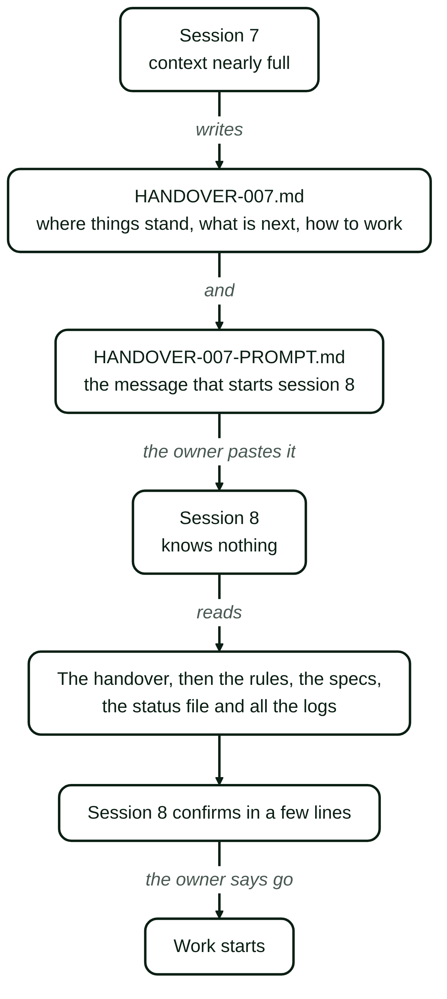

# Chapter 8: Handover prompts

Every AI session ends. The context fills up, the tool restarts, or you stop for the night. The next session knows nothing: not the plan, not the decisions, not which tile is which, not the mistake you corrected an hour ago.

A **handover** is the file the outgoing session writes so the incoming one can start cold and lose nothing. A **handover prompt** is the short message you paste to start the new session and point it at that file. Together they are how a project lasts longer than any one conversation.

- **Templates:** [`handover.md`](../templates/handover.md) and [`handover-prompt.md`](../templates/handover-prompt.md)
- **The real example:** the eight handovers written during the build of [open-office-harness](https://github.com/frozenfussion/open-office-harness)

---

## 8.1 The idea

<p align="center"></p>

Three things are true of a good handover:

1. **The new session can start from it alone.** Everything else it needs is named in it, with paths.
2. **It is checked, not remembered.** Every "where things stand" line was verified at the time of writing.
3. **It carries the lessons**, not only the state. The mistakes of this session, and the rule that prevents each, travel forward.

The logs (chapter 7) are the memory. The handover is the index to it, plus everything the logs do not say: how to reach things, what to do first, and how this owner likes to work.

---

## 8.2 When to write one

| Moment | Why |
|---|---|
| The session's context is getting full | Quality drops before the limit. Hand over while you can still write a good one |
| The end of a working day | Tomorrow's session is a new one |
| A stage has just been accepted | The cleanest possible break |
| Before a risky or long operation | If the session dies in the middle, the next one can pick up |
| You are switching tools or models | The new one shares nothing with the old |

Do not wait until the session is failing. A handover written by an agent that has already lost the thread passes the confusion on.

---

## 8.3 The handover file, section by section

| # | Section | What it holds |
|---|---|---|
| 0 | **Start here** | What to do first, in order, without being asked |
| 1 | **Read list** | Every file to read, with its path and why |
| 2 | **Where things stand** | The state, each line checked, with the date and time |
| 3 | **The system** | What is running, where, at which version |
| 4 | **Reaching things** | Machines, folders, terminal tiles, which key or login is whose |
| 5 | **What comes next** | The plan, in order, marked as the owner's choice |
| 6 | **How to work with the owner** | The standing rules for communication |
| 7 | **Logs and tickets** | What to update, and when |
| 8 | **Mistakes this session, and the rule that prevents each** | The lessons |
| 9 | **What worked** | The moves worth repeating |
| 10 | **Open items** | Everything unfinished or unknown |
| 11 | **What NOT to do** | The fences |
| 12 | **Your confirmation** | Exactly what the new session should send back |

A short session needs only 0, 2, 5 and 10. A long build needs all of them.

**The real example.** These are the section headings of the last handover of the build:

> 0. Your first hour, in order (do all of it without being asked)
> 1. Read list (all of it, every line)
> 2. Where things stand (15 Nov 2026, 04:50 MYT; every line here was checked tonight)
> 3. The system [...]
> 4. Reaching the server, keys and the tmux tiles
> 5. Browser, email and what Aziz sees
> 6. What comes next (Aziz decides the order; propose, then wait)
> 7. How to work with Aziz [...]
> 8. Logs, Jira and the repositories (every turn where something happens)
> 9. Mistakes made in session 008, and the rule that prevents each
> 10. What worked (repeat it)
> 11. Open items carried
> 12. What NOT to do
> 13. Your confirmation (final reply, short, not between tool calls)

Read the brackets. "Do all of it without being asked." "Every line here was checked tonight." "Aziz decides the order; propose, then wait." Each heading carries an instruction, so even a session that skims gets the rule.

---

## 8.4 Writing each section well

### Start here

The first minutes of a new session decide the rest. Tell it exactly what to do, in order, and when to stop.

```
## 0. Start here
1. Read this file to the end.
2. Read every file in section 1, every line.
3. Check the state in section 2 against the real thing (git log, the status file, the board).
4. Send the confirmation described in section 12.
5. Start no work until the owner agrees.
```

**The real example.** A short handover from the middle of the build opens with:

> Read this, then PROJECT_INSTRUCTIONS.md [...], then all of logs/. Confirm in two or three lines; start no work until Aziz agrees.

### Read list

Name every file, with its path. "Read the docs" is not a read list.

```
## 1. Read list
| File | Why |
|---|---|
| docs/specs/00-GLOBAL-RULES.md | The rules. Section 9 is how to talk to the owner |
| docs/specs/stage-3-<name>.md | The stage in progress, including its change table |
| docs/STATUS.md | What is built and proven |
| logs/SESSION_LOG.md | All of it. Read long files in parts |
| logs/DECISIONS.md | Do not re-argue any of these |
| logs/HANDOVER-006.md | The previous handover; its system section still holds |
```

Say when a file must be read in parts, and mention any trap in reaching the files. A new session that fails to open a file will often carry on without it and not tell you.

### Where things stand

The most important section. One line per fact, each with the identifier that lets it be checked.

```
## 2. Where things stand (4 Mar, 18:20; every line checked now)
- Stage 2 ACCEPTED by the owner 4 Mar 17:55 (decision 41). main = a1b2c3d. Tag v0.2.
- Live system runs image tag a1b2c3d4e5f6. Check scripts: 61 PASS, 0 FAIL at 17:40.
- Part C's branch stage-3-part-c exists, 2 commits, review not started.
- NOT DONE: the user guide's restart section.
- NOT KNOWN: why the nightly job ran twice on 3 Mar.
```

Three habits:

- **Verify at the time of writing.** Run `git log`, run the check, look at the board. Then write.
- **Separate done, not done and not known.** A reader should never have to guess which a line is.
- **Give identifiers:** commit hashes, tags, file paths, decision numbers, ticket names.

**The real example.** From a mid-build handover:

> - Stage 4 phase 1 ACCEPTED by Aziz 12 Nov 22:56 (D102). main = b7ac55e [...]. Tag `class-start` (code = 7c721a4de601). docs/STATUS.md has the Stage 4 section.
> - Live system on harness runs 7c721a4de601; checks 40/62/70/77/78: 199 PASS, 0 FAIL.

Every claim there can be checked in under a minute: a decision number, two commit hashes, a tag, and a count.

It also records a change in the working setup that would otherwise have confused the next session badly:

> - tmux on harness after the reboot: session "harness", windows 1 shell, 2 audit, 3 fix (Codex, idle), 4 review. The old six-tile layout is gone.

### Reaching things

Machines, folders, tiles, logins. Say whose each key or login is. **Never write a secret.** Write where it lives and who types it.

```
## 4. Reaching things
- Build machine: ssh <user>@<host>. Your key is added by the owner; ask in your confirmation.
- tmux session "work": 0 Builder A, 1 Builder B, 2 Reviewer, 3 Shell (owner's).
- The cloud console: the owner signs in; you never see the password.
```

### What comes next

A numbered list, clearly the owner's to reorder.

**The real example.**

> ## 2. Next plan (Aziz chooses the order)
> 1. Teaching material for Stage 4 [...]
> 2. AWS phase [...]: spec → spec review → [...] → terraform plan (Aziz's yes per paid resource) → apply → [...] → destroy. Open design point: [one technical question, in one sentence].
> 3. Tidy-ups [...]

Notice "Aziz's yes per paid resource" inside the plan. The approval points travel with the plan.

### Mistakes, and the rule that prevents each

This is the section that makes each session better than the last. Write it as pairs.

```
## 8. Mistakes this session, and the rule that prevents each
| Mistake | Rule |
|---|---|
| Said "fixed" after the database showed the right value; the screen still showed the old one | Never say fixed until the thing the person sees is checked |
| Asked the owner a question the decisions file already answered | Search the whole record before asking |
| Announced a check time, then did not schedule the check | Schedule first, announce second; times come from the clock |
```

Those three are real, paraphrased from the build's own standing rules. Each began as a mistake in one session and became a rule for every later one.

When a lesson should hold for good, it also goes into the rules file or the standing instructions, with its date. The handover carries it forward once; the rules keep it.

### What NOT to do

A short list of fences that matter right now.

```
## 11. What NOT to do
- Do not run the realm sync script; it would overwrite a change made by hand on 3 Mar.
- Do not push to main.
- Do not start the cloud phase without the owner's yes for each paid resource.
```

### Your confirmation

Tell the new session exactly what to send back, and how short.

```
## 12. Your confirmation
One short message:
- at the top, anything the owner must do for you (for example, add your key);
- the plan, in two or three plain lines;
- a small table of what you read, with line counts;
- at most one question, or "No questions".
Then wait.
```

The table of what was read, with line counts, is a simple honesty check. A session that says "I read everything" and lists 40 lines for a 1,100-line log did not.

---

## 8.5 The handover prompt

The handover is a file. The prompt is the short message that makes a new session open it. Keep it in its own file so the owner can paste it.

```
You are the planner for session <N> of <project>. <One line on where things stand.>
We are starting <what is next>.

Your handover is logs/HANDOVER-<N-1>.md.

Read it in full, then do everything in its section 0, in order, without waiting for me:
- read every line of every file in its read list;
- check the state it describes against the real repo and board.

Do not ask me anything the record answers. Do not skip important things and do not
fixate on trivial ones. Never claim something works without testing it.

Then send one short confirmation:
- at the top, anything I must do for you;
- the plan, in two or three plain lines;
- a short table of what you read, with line counts;
- at most one question, or "No questions".

Start no work until I agree.
```

**Why each part is there.**

| Part | Why |
|---|---|
| The role, in the first words | The session knows what it is before it reads anything |
| One line of state and one of goal | Enough to orient; the detail is in the file |
| "without waiting for me" | Otherwise it stops after every file to ask permission |
| "every line" | Otherwise it reads the first screen of each |
| "Do not ask me anything the record answers" | Protects the owner's time |
| The exact shape of the confirmation | You get a short, checkable answer instead of an essay |
| "Start no work until I agree" | The owner sets the direction of every session |

**The real example.** The build's prompts follow that shape almost line for line. One of them tells the new session to read "every line of every file" in the handover's read list, to search past conversations for decisions that never reached the files, and ends:

> Start no build work until I agree. From then on, follow the handover and [the project instructions]: announce before acting, act where I can watch, keep the logs and [the ticket board] updated in every turn, keep messages short with my action at the top.

It also warns about a real trap in reaching the files (they were cloud-only and had to be fetched before reading, or the read failed with an odd error). That one sentence saved every later session from rediscovering it.

---

## 8.6 Handing over to builders and reviewers

Builders and reviewers need far less, because the spec is their handover.

**A builder that must be restarted** (a crash, a reboot, a full context):

```
You are Builder B for Stage 3, restarting. Your folder is ~/projects/worktrees/stage-3-part-b.
Read AGENTS.md, the rules file and the stage spec, including its change table.
Then read your own history: git log stage-3-base..HEAD and git status.
Tell me in five lines what is done and what is left of Part B. Change nothing yet.
```

Git is the builder's memory. Its commits say what it did; the spec says what remains.

**A reviewer** always starts cold, on purpose (chapter 6). Its "handover" is the review request.

---

## 8.7 Standing instructions: the handover that never changes

Some things are true for every session: who the owner is, how they want to be spoken to, where the files live, the method. Put those in a file every session reads first, or in your AI tool's project instructions, and keep only the *changing* state in the handovers.

| Goes in standing instructions | Goes in the handover |
|---|---|
| Roles and the method | Where the current stage stands |
| How to talk to the owner | What this session got wrong |
| Where the logs, repos and boards are | What comes next |
| Rules that have accumulated, by date | Temporary fences ("do not run X this week") |

**The real example.** The build kept a standing instructions file with numbered sections, and it grew by one section per session: "standing rules added in build session 003", "...004", "...005", each a handful of lines. The first line of the relevant section tells every new session what to do before anything else: read the newest handover, then the instructions, then all of the logs; confirm in two or three lines; start nothing until the owner agrees.

---

## 8.8 Testing a handover

The only real test is to use it. But before the old session ends, you can ask it:

```
Pretend you are a new session with only this handover and the files it names.
List everything you would have to guess or ask. Then add those to the handover.
```

And at the start of the new session, compare its confirmation with what you know:

| The confirmation shows | It means |
|---|---|
| The plan matches yours | The handover worked |
| Small line counts for big files | It skimmed. Send it back to read |
| A question the files answer | It skimmed. Tell it where the answer is |
| A plan that reopens a settled decision | It did not read the decisions file |
| A different idea of what is "done" | The "where things stand" section was not specific enough |

**The real example.** The build's journal records the first use: the owner opened a new session with only the handover file attached, the planner read it, the instructions, the logs and the plan, and confirmed in a few lines. The lesson written next to it: a good handover lets a fresh session start in minutes; the handover is the bridge, not the human's memory.

The build's standing rules record the opposite, too. A later session asked the owner a question that an early planning conversation had already answered, because that answer had never reached a file. The rule that followed: before asking, search *all* of the record, including past conversations, and write down decisions where the next session will find them.

---

## 8.9 Common mistakes

| Mistake | What it causes | Do this instead |
|---|---|---|
| Writing the handover from memory at the very end | A confident, wrong picture of the state | Verify each line as you write it |
| "Read the docs" | The session reads two files | A read list with paths |
| State without identifiers | Nothing can be checked | Hashes, tags, paths, numbers |
| Only successes | The next session repeats this one's mistakes | A "mistakes and rules" section |
| Leaving out "not done" and "not known" | The next session assumes they are done and known | Three kinds of line, clearly marked |
| No instruction to wait | The new session starts building on its first guess | "Start no work until I agree" |
| Putting a password in it | A secret in a file forever | Say where it lives and who types it |
| One handover file, overwritten each time | The history is lost | Number them; keep them all |
| Waiting until the context is full | A handover written by a confused agent | Hand over early |

---

## 8.10 Checklist

- [ ] The handover has a "start here" with numbered first steps and "start no work until the owner agrees".
- [ ] A read list with paths.
- [ ] "Where things stand", each line verified, with done, not done and not known kept apart.
- [ ] How to reach machines, folders and tiles, with no secrets.
- [ ] What comes next, marked as the owner's to order, with approval points.
- [ ] This session's mistakes, each with a rule.
- [ ] What not to do.
- [ ] The exact confirmation to send back.
- [ ] A separate prompt file the owner can paste.
- [ ] Handovers are numbered and kept.
- [ ] Lasting lessons were also added to the rules or standing instructions.

---

**Next:** [Chapter 9, project management](09-project-management.md).
