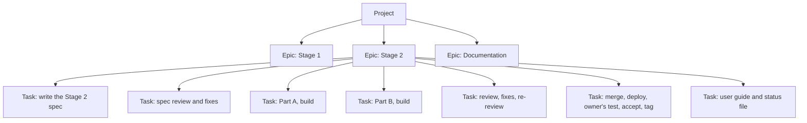
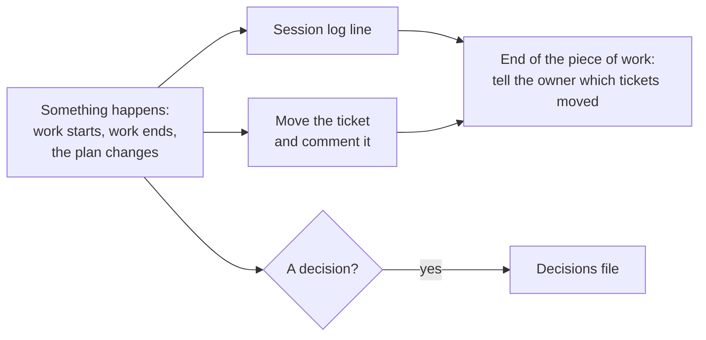

# Chapter 9: Project management

The specs say what to build. The logs say what happened. Neither gives you, or anyone you report to, a view of the whole project at a glance: what is done, what is in progress, what is next. That is the job of a ticket board.

This chapter shows how to run one alongside AI agents so that it stays true without becoming a second job. It works with any tracker: Jira, GitHub Projects, Linear, Trello, or a table in a text file.

- **The real example:** the Jira board kept during the build of [open-office-harness](https://github.com/frozenfussion/open-office-harness)

---

## 9.1 Why bother, when you already have specs and logs

| The board gives you | That the files do not |
|---|---|
| One screen showing everything | A spec shows one stage; a log shows one day |
| A view for other people | A manager or a client will look at a board; they will not read a session log |
| A check on the planner | If the board and the logs disagree, something was missed |
| A place for work that is not code | Documents, slides, tidy-ups, things waiting on someone |
| A simple answer to "what is next?" | The top of the "to do" column |

And one thing it must **not** become: a second source of truth. The spec is the truth about what to build. The board points at it.

---

## 9.2 The mapping

Keep the shape of the board identical to the shape of the work.



| In the method | On the board |
|---|---|
| The product | A project |
| A stage, or an area of non-code work | An epic |
| A step of the stage's loop, or one Part | A task under that epic |
| The spec | Linked from the epic and from each task |
| A finding that needs real work | A task (small ones stay in the fix request) |
| An open item carried to "later" | A task in the backlog, under the epic it belongs to |

**A standard set of tasks per stage** makes every stage look the same on the board, so missing steps stand out:

1. Write the spec
2. Review the spec; fix; re-review
3. One task per Part: build
4. Review each Part; fixes; re-review
5. Merge; checks on a clean copy
6. Deploy; the owner's test; accept; tag
7. Documentation, status file, logs, handover

---

## 9.3 Three columns are enough

| Column | Means | Rule |
|---|---|---|
| **To do** | Agreed, not started | Ordered: the top is next |
| **In progress** | Someone is working on it now | Moved here the moment work starts, not after |
| **Done** | Finished and proven | Only when its own "done when" is met |

"Done" on the board means the same as "done" in the spec. A build task is done when the Part's checks pass and the report is in, not when the builder stops typing. An epic is done when all its tasks are done.

---

## 9.4 The four rules

**1. Move it when it starts, move it when it ends.** A ticket moved an hour late is a board that was wrong for an hour, at exactly the moment someone looked.

**2. Comment every move.** One or two lines: what was done, and the identifier that proves it.

```
Part A built on branch stage-2-part-a, commit 1f61e27. 129 tests pass.
Report: reviews/stage-2-part-a-report.md. Review starting.
```

A column tells you *that* a ticket moved. The comment tells you *why you can believe it*.

**3. When the plan changes, change the board in the same session.** Add, edit or close tickets as part of making the decision. A plan change that reaches the board tomorrow is a board that lies today.

**4. The board always matches the plan and the logs.** If they disagree, stop and find out which is wrong. Usually the board. Sometimes a missing log line, which is worse.

**The real example.** These are the standing rules from the build, almost word for word:

> - One epic per stage or area, one task per piece of work.
> - Move a task to In Progress when work on it starts, and to Done when it is finished. An epic goes to Done when all its tasks are done.
> - When the plan changes, change [the board] in the same session (edit, add or close tasks). [The board] always matches the plan and the logs.
> - Show [the owner] progress [on the board] at the end of each piece of work (which tickets moved).

and, added later:

> Move AND comment every ticket.

---

## 9.5 Let the planner keep the board

Updating tickets by hand is the chore that kills every board. The planner AI is already writing the logs in every turn. Give it access to the tracker and make the board part of the same motion.



How the planner reaches the tracker depends on your tools: a connector or integration if your AI tool has one, the tracker's command-line tool, or its API. If none of those can do a particular thing, a browser session the owner is signed in to is the fallback. The owner types passwords; the planner never sees them.

**What to tell the planner, once, in the standing instructions:**

```
The board is at <where>. One epic per stage or area, one task per piece of work.
- Move a task to In Progress when its work starts and to Done when it is finished.
- Comment every move: what was done, and the commit, file or check result that proves it.
- When the plan changes, change the board in the same session.
- At the end of each piece of work, tell me which tickets moved.
- At the start of a session, open the board and check it against the logs before anything else.
```

That last line matters. A new session that compares the board with the logs finds the gaps of the last one.

**The real example.** The planner in the build kept the board through a connector to the tracker, with the browser as the fallback. The journal records what happened when it did not: early on, the owner noticed the board had not been opened and said so, in words to the effect of "you have not read the logs properly, or you would have opened the board". The planner had read the rule and not acted on it. From then on, showing the board at the start of a session became part of the handover prompt itself: "open [the board] in a new tab [...] and check it against the logs".

---

## 9.6 Linking everything

A ticket should take you to the evidence in one click, and the evidence should take you back.

| From | To | How |
|---|---|---|
| Epic | The stage spec | A link in the description |
| Build task | The branch and the report | Branch name and file path in a comment |
| Review task | The review file | Path in a comment |
| Acceptance task | The tag and the decision | Tag name and decision number in a comment |
| Handover | The tickets in flight | Ticket names in a "tickets" section |
| Session log | The ticket | The ticket's name on the log line |

**The real example.** A mid-build handover has a short section for the board that reads, in shortened form: the fix-round ticket is Done; the "reviews, accept, tag, instructor guide" ticket is still In Progress *for the instructor guide*; the stage's epic stays In Progress until the cloud phase is done. Three lines, and the next session knows exactly which tickets are open and why.

When you write about tickets to a person, say what the ticket *is*. "The fix-round ticket" means something. A bare ticket number does not, and the build made that a rule: never refer to things only by internal numbers.

---

## 9.7 Work that is not code

A real project has work around the code, and it is the first thing to be forgotten. Give each area its own epic.

| Area | Typical tasks |
|---|---|
| Documentation | User guide per stage; architecture page; overview with diagrams |
| Operations | Server setup; backups; cost limits; taking a temporary environment down |
| Waiting on someone | An access request; a decision from another team |
| Tidy-ups | The "open for later" items from the status file |
| Material | Slides, handouts, demos, if you teach or present the work |

The "open for later" list in the status file (chapter 7) and the backlog on the board should say the same things. The status file is the record; the board is where the item waits to be picked up.

---

## 9.8 If you do not want a tracker

For one person on a small project, a text file does the job:

```
# BOARD.md

## In progress
- Stage 2 / Part B build. Branch stage-2-part-b. Started 4 Mar 11:41.

## To do (top is next)
- Stage 2 / review Part A
- Stage 2 / review Part B
- Stage 2 / merge, deploy, owner's test, accept, tag
- Docs / restart section of the user guide

## Done
- 4 Mar 11:30 Stage 2 / spec review, fixes, re-review. reviews/stage-2-spec-review.txt
- 4 Mar 10:40 Stage 2 / spec written. Commit a1b2c3d, tag stage-2-base.
```

The four rules still apply. The file lives with the logs, and the planner keeps it.

---

## 9.9 Common mistakes

| Mistake | What it causes | Do this instead |
|---|---|---|
| Updating the board at the end of the day | It is wrong whenever anyone looks | Move tickets in the turn the work starts or ends |
| Moving without commenting | Nobody can tell why it is "done" | One line and an identifier on every move |
| Tickets that restate the spec | Two versions of the truth | Link to the spec |
| A ticket per tiny finding | A board nobody can read | Small findings stay in the fix request |
| "Done" when the builder stops | Unreviewed work marked finished | Done means the task's own "done when" is met |
| Changing the plan and not the board | The board describes last week's plan | Same session, always |
| Only code on the board | Documentation and tidy-ups never happen | An epic per area |
| Ticket numbers in messages to people | Nobody knows what you mean | Say what the ticket is |

---

## 9.10 Checklist

- [ ] One epic per stage and per area of non-code work.
- [ ] The same set of tasks under every stage's epic.
- [ ] Every epic links to its spec.
- [ ] Tickets move when work starts and when it ends.
- [ ] Every move has a comment with an identifier.
- [ ] Plan changes reach the board in the same session.
- [ ] The planner has access to the board and the rules for it in its standing instructions.
- [ ] Each session starts by checking the board against the logs.
- [ ] Handovers list the tickets in flight.
- [ ] "Open for later" items are on the board.

---

**Next:** [Chapter 10, the worked example](10-the-worked-example.md).
