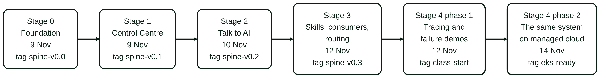
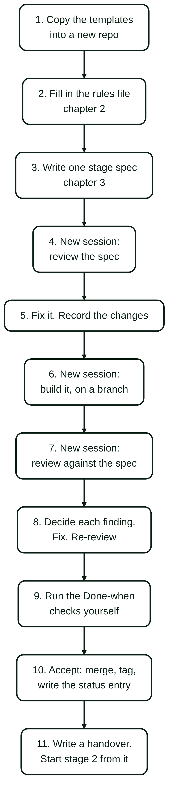

# Chapter 10: The worked example

Every chapter so far has borrowed pieces from one real build. This chapter tells that build from start to finish: what was built in each stage, how the work was split, what the checks showed, what went wrong, and what changed because of it.

The product is [open-office-harness](https://github.com/frozenfussion/open-office-harness): a system that lets people in an organisation talk to AI models and use AI "skills", with rights, approvals and an audit trail controlled by an administrator. It is public, and everything quoted here can be read in its repo:

| What | Where |
|---|---|
| The rules | [`docs/specs/00-GLOBAL-RULES.md`](https://github.com/frozenfussion/open-office-harness/blob/main/docs/specs/00-GLOBAL-RULES.md) |
| The specs, one per stage | [`docs/specs/`](https://github.com/frozenfussion/open-office-harness/tree/main/docs/specs) |
| What was built, checked and left open | [`docs/STATUS.md`](https://github.com/frozenfussion/open-office-harness/blob/main/docs/STATUS.md) |
| Every accepted stage, as a tag | [Tags](https://github.com/frozenfussion/open-office-harness/tags) |

You do not need to understand its tech stack to follow this chapter. Read it for the *shape* of each stage.

---

## 10.1 The whole build on one line

| Stage | What existed afterwards | Builders in parallel | Spec review findings | Live checks at acceptance |
|---|---|---|---|---|
| 0 | A secure, empty platform and every contract between modules | 2 | (not counted here) | 27 PASS, 0 FAIL |
| 1 | The service that decides rights, keeps registries, handles approvals and audits itself | 2 | 30, then 8 on re-review | 49 PASS, 0 FAIL |
| 2 | A person can sign in and chat with a real model; an admin manages models and tiers | 4 | 38, then 8 on re-review | 46 PASS, 0 FAIL |
| 3 | Skills run as background jobs; three read-only listeners; automatic routing | 4, then 1 more for phase 2 | 38, then 14 on re-review | all PASS after a reboot |
| 4 phase 1 | One trace per request across every service; failure demos with replay | 4 | 25, then 8 on re-review | 199 PASS, 0 FAIL |
| 4 phase 2 | The same system on managed cloud Kubernetes, created and removed by code | 2 | (not counted here) | all PASS, including replacing the machine under it |

Each stage has two tags: `stage-N-base`, where every builder started, and an acceptance tag. You can check out any of them and see the product exactly as it was.

---

## 10.2 Before Stage 0: planning

Nothing was built until four things existed:

1. **The architecture**, as a document and a picture: which modules, and what each may say to which other.
2. **The contracts**: the agreements between modules, as files a machine can check (API descriptions, message schemas, who may read and write each topic).
3. **The rules file** (chapter 2), agreed line by line by the owner.
4. **A stage plan**: an ordered list of stages, each ending in something that can be shown working.

The contracts deserve a word. They are what made four parallel builders possible two stages later: each builder built one module against the contract, not against another builder's code. The rule in the fixed decisions is one sentence:

> A module talks to another only through a contract.

**The order of stages** followed one principle: each stage ends with something real that the next stage stands on. Platform first, then the service everything else asks for permission, then the first thing a user can see, then the harder asynchronous parts, then observability, then the move to another home.

---

## 10.3 Stage 0: foundation

**Purpose, from the spec:**

> Turn an empty Droplet and an empty repo into a running, secure, **empty** platform that every later stage builds on without changing it [...]. No product code yet.

**The split.** Two Parts, cut as "the repo's shape" versus "the running platform":

| Part | Owned |
|---|---|
| A | The repo skeleton and every contract |
| B | The platform's deployment files and the install and check scripts |

**The proof.** A platform check script that prints one PASS or FAIL per line. At acceptance: 27 PASS, 0 FAIL, and the same again after a reboot.

**What changed during the build.** The spec's change table has 16 entries from a single day. The second is the most instructive:

> Files are stored on the Droplet disk in a Kubernetes volume [...]. **No DigitalOcean Spaces, no S3 server.** Prerequisite 4 (Spaces) is removed [...] | Aziz, 16:18

The first version of the spec planned an object storage service. The owner looked at it and removed it: the product did not need it yet. A whole piece of technology, a prerequisite, and its cost disappeared in one line, before anyone built on it. That decision is quoted again in the next spec's "owner's words", and it became a line in the rules.

**What Stage 0 teaches.** Build the empty platform and its check first. Every later stage then starts from "27 PASS" and can tell at once whether it broke something underneath.

---

## 10.4 Stage 1: the first real service

Chapter 3 goes through this spec section by section. The story in short:

- **Purpose:** replace a placeholder with one program that answers rights checks, keeps two registries, handles approvals and records its own audit trail.
- **Split:** Part A the code, Part B getting it running.
- **Spec review:** 30 findings, then 8 more from the fixes, all folded in before any builder started.
- **During the build:** a gap between the Parts surfaced when one builder asked for something only the other could produce (chapter 4, section 4.7). Part reviews led to two batches of decisions, each recorded in the change table.
- **The first live run** found four things no review had caught. The spec's change table lists them: the program listened on the wrong port, the small container image lacked a system library, a stray newline in a secret, and a sign-in step that needed an extra parameter.
- **The proof:** 49 PASS, 0 FAIL, and again after a reboot, with the platform's 27 still passing.

**One permission step.** To act as an administrator before any admin screen existed, the check script needed the owner's real identity. The spec chose a sign-in where the script shows a link and a code and the owner signs in in his own browser. It is marked in the spec as accepted only until the admin screens exist, and a later stage switched it off again. A temporary door, with the date it closes written next to it.

**What Stage 1 teaches.** Reviews find what can be read. Only running finds the rest. And the first split of a project will have a seam nobody saw.

---

## 10.5 Stage 2: four builders at once

**Purpose, in the spec's own first sentence:**

> A signed-in person opens [the app], picks a chat tier they are allowed, types, and sees a real model's answer stream in word by word.

**The split.** Four Parts, one per service or app (chapter 4, section 4.3). Two more terminal tiles were added for the two new builders, and the existing four kept their numbers.

**A decision that shaped everything.** The day the stage began, the owner laid down a rule that went straight into the fixed decisions:

> **No AI model name, vendor, address or key in code or config in the repo** (Aziz, 10 Nov 2026: "There's not going to be any hard code").

Which model answers is a row an administrator adds on a screen. Tests use a fake model. Every builder, in every later stage, was held to that by item 4 of the review checklist.

**During the build.** In the first half hour, four builder questions became four entries in the change table, each naming who asked. Two builders asked about the same thing (paging) eight minutes apart, and got one answer.

**The spec grew.** Two features were added while the stage was being built: a "test connection" button for a model, and a way for a user to request access. Each was written into the spec as its own numbered section headed "added during the build; binding", reviewed like the rest, and split across the Parts by file. The stage did not drift; the spec moved, on the record, and the build followed.

**The proof.** The stage check: 46 PASS, 0 FAIL. It includes answers from three different kinds of model provider, and a check that no key ever appears in a log.

**What Stage 2 teaches.** Four builders are manageable when each owns a vertical slice and they meet only at contracts and a table of fixed names. And when the owner wants something new mid-stage, it goes through the spec, not around it.

---

## 10.6 Stage 3: the asynchronous part

**Purpose.** A user asks for slides in the chat. The model calls a skill; the job goes onto a message queue; the chat answers at once; a separate worker builds a real file; the job card turns from "queued" to "ready". Three read-only listeners watch the same queue: one writes the audit trail, one counts cost, one watches for unsafe content. Messages that fail three times go to a dead-letter queue.

**The split.** Four Parts as before, then a fifth for a second phase:

> Part E, Classifier routing (phase 2; branch `stage-3-part-e` from `pre-routing` [...])

Phase 1 was merged and tagged `pre-routing`. Phase 2 started from *that* tag. A tag in the middle of a stage gave the risky feature a clean place to start from, and a clean place to return to if it failed.

**Spec review.** 38 findings; the re-review found 37 fixed, one left for the owner to decide, and 14 new.

**Part reviews.** Some Parts needed a second re-review before they came back clean.

**The proof.** All check scripts PASS with 0 FAIL, after a reboot.

**A rule born here.** The safety listener asks an AI model to judge content. The standing rule that came out of this stage: before an AI is asked to judge anything, write the rule down, and set any threshold from measured, labelled examples. An AI's judgement is only checkable if you first said what it should be.

**What Stage 3 teaches.** Use a tag as a checkpoint inside a stage. Expect more review rounds when the work is asynchronous. And when part of your product is itself an AI making a judgement, specify the judgement as carefully as you specify the code.

---

## 10.7 Stage 4 phase 1: seeing inside, and breaking it on purpose

**Purpose.** Every request becomes one trace across all services, including across the message queue. And three failures are staged deliberately, each with a script: a worker switched off (the job waits and finishes when the worker returns), a duplicate message (one result, not two), and a dead letter that is replayed after its cause is fixed.

**The split.** Four Parts, the same four owners as Stage 3. Keeping the same ownership across stages meant each builder's file list looked familiar, and so did each review.

**Spec review.** 25 findings, then 8 new on re-review.

**The independent audit.** After the Parts were merged and reviewed, a separate reviewer audited the whole against the spec. It found a real security issue: one service accepted a trace identifier supplied from outside. That went through one fix round (a fix report, a review, a re-review) and was then proven on the live system: a forged identifier sent to the public address was refused and never appeared in the tracing system.

**The proof.** 199 PASS, 0 FAIL across all five check scripts, before and after a reboot.

**What Stage 4 teaches.** A final review of the merged whole finds things the Part reviews cannot, because some problems only exist where the Parts meet. And failure demos are checks too: a system you have never broken on purpose is a system you do not yet understand.

---

## 10.8 Stage 4 phase 2: a second home

**Purpose, from the spec:**

> Prove that the class system is portable: the platform and the nine services that run on the k3s Droplet run unchanged on Amazon EKS, with everything on AWS created by Terraform and removed by Terraform. Same Docker images [...], same manifests, a different values file [...].

This is where a rule written on day one was collected on. The fixed decisions had said: the same manifests, different values. A reviewer in Stage 1 had flagged files that wrote values out literally (chapter 6, section 6.6). Five days later those same files were deployed to a different cloud with a different values file.

**The split.** Two Parts: the cloud infrastructure code and its scripts; and the changes that let every install script target either home and refuse the wrong one.

**The human gates.** This stage spent real money, so the spec put the owner's yes on each paid resource, a cost limit in the infrastructure code itself, and a "paid guard" in the script that prints prices before it creates anything.

**The proof.** Every check script passed on the cloud copy. One extra check replaced the machine underneath the running system: the new machine and the old disk were swapped in 190 seconds, and every part was ready again about 13 minutes after the start with no manual fix.

**Then it was taken down.** With the owner's separate yes, the cloud copy was destroyed by the same code that made it. The status file's top section is the honest record of that teardown: the script missed one resource and stopped; the exact command used by hand is written down, with "with Aziz's yes"; and the item is listed as open for a fix round and review.

**What this stage teaches.** Rules about portability and pinning feel like overhead until the day you move. Put the human approval where the money is. And the teardown belongs in the spec and the status file just like the build.

---

## 10.9 What went wrong, and what it changed

This table is the most useful part of the chapter. Each row is a real problem and the rule or habit that came from it.

| What went wrong | When | What changed |
|---|---|---|
| The first plan included a storage service the product did not need | Stage 0 | "Do not unnecessarily add a tech stack"; the simplest step that does not cut corners |
| A Part's finish line needed another Part's output | Stage 1 | Per-Part checks need only that Part's files; whole-stage checks run after the merge |
| Four problems appeared only on the first live run | Stage 1 | The owner's live test is a step of its own; live fixes go into the spec's change table |
| New files wrote out values that earlier files had made configurable | Stage 1 review | Caught by review against an earlier stage's convention; paid off at the cloud move |
| Two builders needed the same index file | Stage 2 | The spec gave one Part its own index file |
| The planner asked the owner something an early conversation had already answered | Mid-build | Search the whole record, including past conversations, before asking |
| The planner said "fixed" when the database was right and the screen was not | Stage 3 | Never say fixed until the thing the person sees is checked |
| A check time was announced and the check was not scheduled | Stage 3 | Schedule first, then announce; times come from the clock |
| The planner went quiet while working | Stage 4 | Answer at once in a line or two, then work |
| One service trusted an identifier from outside | Stage 4 audit | An independent audit of the merged whole before acceptance of a risky stage |
| The teardown script missed a resource | After the cloud phase | Recorded as open in the status file, with the manual step, for a fix round |

Half of these are about the builders' code. The other half are about the planner and the process. Both kinds went into the rules.

---

## 10.10 How the rules grew

On day one the rules file was written "adapted from" an earlier project's rules. By the end it carried dated additions from the build itself:

| Date | Addition | From |
|---|---|---|
| 9 Nov | No storage service; files on a volume | The owner, during Stage 0 |
| 9 Nov | Container images built by the code host's pipeline, tagged with the commit hash | The owner, before Stage 1 |
| 10 Nov | No model name, vendor, address or key in the repo | The owner, at the start of Stage 2 |
| 10 Nov | The planner may run non-privileged scripts in the owner's shell tile while he watches | The owner, from Stage 2 |
| 10 Nov | Two agreed exceptions to the secrets rule, each with its limit | Stage 1 and Stage 2 |

A rules file that has not changed during a real build was either perfect or unread.

---

## 10.11 The numbers, honestly

| Measure | Value | What it does and does not tell you |
|---|---|---|
| Accepted stages | 6, in 6 days | The pace of one build by one experienced owner. Not a promise for yours |
| Parallel builders | 2 to 4 | The owner's attention was the limit, not the tools |
| Spec review findings per stage | 25 to 38, plus 8 to 14 on re-review | Normal. A spec review that finds nothing was not a review |
| Live check lines by the end | 199 | Every one re-runnable by anyone with the repo |
| Problems found only by running | Several per stage | Reviews do not replace the owner's test |
| Things still open at the end | Listed in the status file | A build with nothing open has an incomplete status file |

---

## 10.12 Try it yourself, small

You do not need a cluster to practise the method. Pick something you could build in an afternoon.

A good first project has: one small service or command-line tool, one stored thing, one check script. For the second stage, split into two Parts and run two builders in two tmux tiles (chapters 4 and 5).

When you have done two stages this way, read a real spec from the worked example again. It will look very different.

---

## 10.13 Where to go in the real repo

| If you want to see | Open |
|---|---|
| A complete spec with a rich change table | `docs/specs/stage-1-control-centre.md` |
| A four-Part split with a "fixed names" table | `docs/specs/stage-2-talk-to-ai.md`, sections 7 and 8 |
| Features added mid-stage, on the record | The same file, sections 16 and 17 |
| A stage with a checkpoint tag inside it | `docs/specs/stage-3-skills-routing-admin.md`, Part E |
| A spec that spends money, with human gates | `docs/specs/stage-4b-aws.md` |
| The honest record | `docs/STATUS.md`, from the top |
| The product at any accepted point | `git checkout <tag>` |

---

**Back to:** [the README](../README.md).
